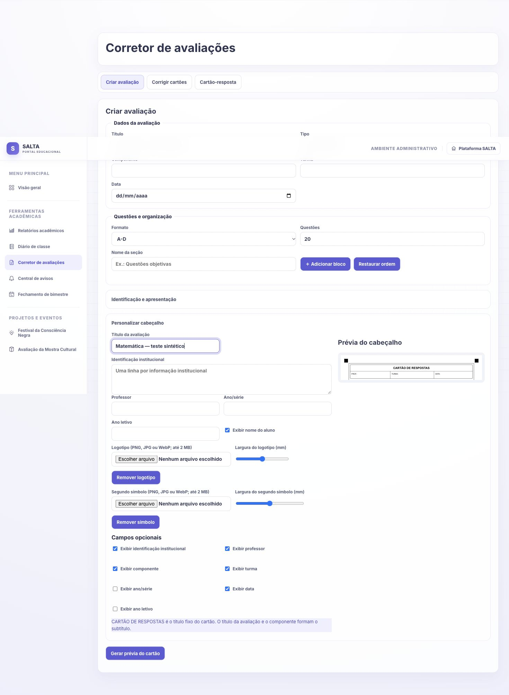
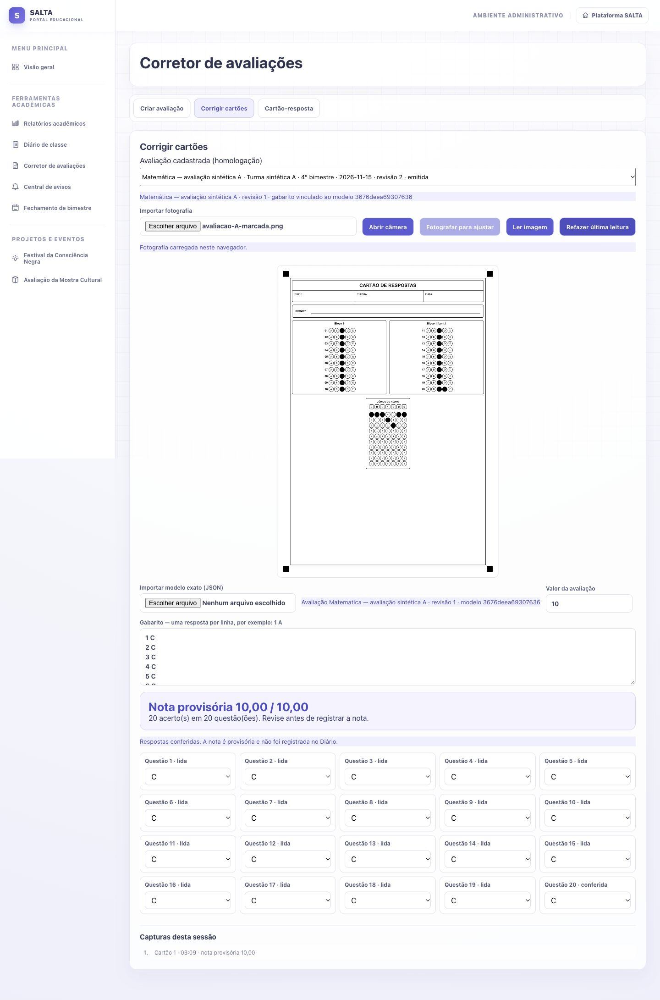
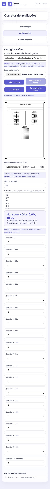
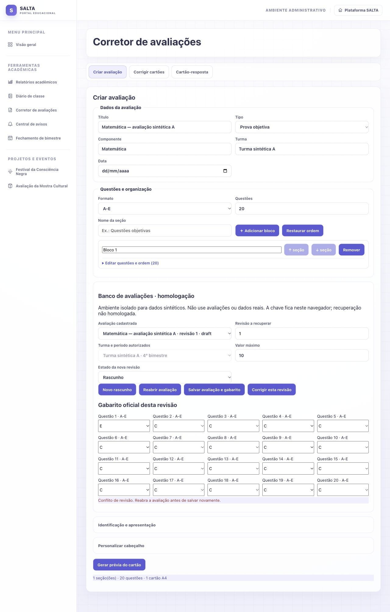

# SALTA — avaliações e gabaritos, Fase 1

> Registro da primeira entrega em `c36b8ed`. Para a continuação autorizada de publicação sintética protegida, consultar [PR36 — publicação protegida](SALTA_PR36_PUBLICACAO_PROTEGIDA.md). Os estados “não publicado” abaixo descrevem essa primeira entrega.

Data: 15/11/2026. Base inicial: PR #34 / `d47bcc3`.

## Resultado e limites de publicação

1. **Cabeçalho direto:** PR [#35](https://github.com/d4nny3l/portal-do-aluno/pull/35), integrado no commit [`20954d2`](https://github.com/d4nny3l/portal-do-aluno/commit/20954d2cd7898dcc389da9890cb604b53577e00b), [CI verde](https://github.com/d4nny3l/portal-do-aluno/actions/runs/43680274002) e [Pages concluído](https://github.com/d4nny3l/portal-do-aluno/actions/runs/43680435744). A página pública autenticada confirmou os controles diretos e a sincronização dos títulos. Sem mudança no cartão ou nos módulos ópticos neste PR.
2. **Banco de avaliações:** implementação funcional em homologação local, com persistência real no D1 local do Wrangler, ciphertext, ACLs sintéticas e integração editor/leitor. D1 remoto próprio preparado apenas com esquema vazio. Worker não publicado e fluxo de banco não liberado na `main`: os bloqueios reais de identidade/autorização/chaves estão descritos abaixo. Isso atende à alternativa de homologação/documentação expressamente prevista no pedido; não é persistência de produção simulada.

Não houve mudança em código/configuração dos Workers oficiais, autenticação, Diário ou bancos acadêmicos. Não foram consultados/exportados alunos, notas, frequência ou gabaritos reais. Código `0001200`, nomes, turmas, gabaritos e imagens dos ensaios são sintéticos.

## Ajustes do cabeçalho publicados

- Personalizar cabeçalho permanece uma seção expansível, inicialmente fechada e independente de Identificação e apresentação.
- Removidas as abas Título/Dados e logotipos; os controles ficam diretamente na seção.
- Título da avaliação editável nos dois locais com um único valor canônico. CARTÃO DE RESPOSTAS permanece fixo; instituição multilinha e subtítulo são distintos.
- Removidos Adicionar campo, a criação de campos personalizados e o aviso permanente redundante. Metadata/campos personalizados históricos e erros reais de capacidade permanecem interpretáveis.
- Logotipos, proporções, dimensões, visibilidade, prévia e geração não foram redesenhados. Testes e fontes do PR #35 preservam integralmente `corretor/v2/omr/`.

Capturas de página inteira podem registrar a barra fixa na posição de rolagem da captura. Isso não corresponde a uma barra inserida no formulário/cartão.

## Auditoria da infraestrutura

Foram lidos `stats-worker/worker.js`, os dois Wrangler oficiais, `auth-worker/worker.js`, módulos OMR/manifestos e contratos/tabelas do Diário. A branch experimental E2EE foi auditada sem fazer merge de sua infraestrutura.

Além dos arquivos locais, foram consultados **somente metadados** da Cloudflare: lista D1 e recursos das versões efetivamente implantadas dos Workers, com tráfego de 100% nas versões verificadas. Nenhum valor de secret, token ou cookie foi solicitado, impresso ou incluído nos arquivos.

| Worker/binding efetivo | Recurso confirmado | Conduta |
|---|---|---|
| `salta-stats` / `DB` | `portal-aluno-2026`, `e7538b0a-891e-408f-a668-75d60ca907e3` | Não consultado/migrado/alterado |
| `salta-stats` / `DIARIO_DB` | `salta-diario-teste`, `44259972-59ed-4ef7-8db8-4fc442e1b90c` | Não consultado/migrado/alterado |
| `salta-stats` / `AUTH` | Service binding `salta-auth`, ambiente production | Não modificado |
| `salta-auth` / `SESSIONS` | Durable Object `SessionStore` | Não modificado |
| Novo laboratório / `ASSESSMENTS_DB` | `salta-assessments-homologacao-20261115`, `fb74f058-06f8-40a5-8327-445bded453e3` | Banco novo e isolado; esquema remoto vazio; execução funcional local |

Versões remotas verificadas: `salta-stats` `a6fb47fd-9dc7-4415-b8e4-8d18928232ac`; `salta-auth` `49a31dae-83f0-45a5-88a4-6922ae4e2859`. Evidência local filtrada: `BINDINGS_REMOTOS_AUDITADOS.json`.

**Limites identificados:** no código auditado, `/session` retorna usuário verificado, enquanto `authenticated()` do Stats reduz a resposta a um booleano. Os contratos do Diário não constituem um cadastro/grant produtivo de proprietário da nova avaliação. O login atual usa uma conta configurada, não fornece por si só autorização para todas as turmas. O cookie `__Host-...` é específico da origem; uma nova API não recebe automaticamente a sessão da API atual.

A branch Crypto Core usa principal de teste em localhost e não está integrada ao Auth Worker produtivo. Não foi promovido esse header a credencial nem inferida autorização a partir de IDs enviados pelo navegador.

## Modelo implementado

| Camada | Conteúdo e vínculo |
|---|---|
| Avaliação | UUID opaco, responsável derivado da sessão do servidor, turma/período autorizados, título/componente/tipo/data/máximo, estado rascunho/emitida/arquivada e revisão |
| Gabarito | ID da avaliação, revisão, status/data, ID estável/número/tipo de cada questão, alternativa validada e peso uniforme 1 |
| Modelo óptico | Manifesto exato, template/revisão/contentHash e vínculo com ID/revisão da avaliação |
| Revisão cifrada | Um bundle autenticado contendo dados, gabarito, manifesto e snapshot do editor; validação cruzada depois de abrir |
| Recibo/idempotência | requestId opaco, SHA-256 do pedido cifrado/ID e revisão confirmada; reenviar o mesmo pedido não duplica |

Esquema versionado: `assessment_principals`, `assessment_grants`, `assessment_roots`, `assessment_revisions`, `assessment_requests`, `assessment_lab_sessions`. Gabaritos/modelos/dados descritivos ficam cifrados; somente metadados necessários para ACL, estado, revisionamento e recuperação são visíveis ao servidor. Não há tabela de respostas de estudantes ou endpoint de lançamento no Diário.

Revisões não recebem UPDATE. Cada salvamento cria uma nova linha, inclusive após emissão, com CAS da revisão anterior em um batch D1 atômico. Uma revisão antiga continua recuperável pelo número explícito. Arquivamento impede novas gravações. A turma/período de uma avaliação já criada não pode ser trocada pelo cliente.

`contentHash` conserva o contrato óptico existente; a integridade criptográfica do bundle é dada pela autenticação AES-GCM/AAD, sem tratar um hash de apresentação como credencial ou assinatura.

## Persistência, migrações e criptografia

Migração `assessments-lab/migrations/0001_assessments.sql` aplicada ao **novo UUID remoto isolado**, e também ao D1 local. A verificação remota retornou zero avaliações, zero revisões e zero principais: não houve seed ou avaliações remotas. As duas identidades/turmas de teste foram semeadas somente localmente. Nenhum Worker foi deployado.

O down versionado desfaz apenas a estrutura do laboratório e sua entrada no ledger do Wrangler. Reversão e reaplicação foram executadas com sucesso em D1 temporário separado. Isso é rollback estrutural, não restauração de registros excluídos. Um laboratório com dados úteis exige backup de ciphertext e preservação das chaves/perfil antes de executar o down.

O adaptador reutiliza cinco arquivos auditados do Crypto Core experimental, ref `78dd2bed96992e7f7b39690abce0aefd7a2fda91`; ver [proveniência](../assessments-lab/crypto/PROVENANCE.md). Preserva AES-256-GCM, HKDF-SHA-256, salt/nonce aleatórios, AAD canônico com escopo/objeto/revisão e CryptoKey não exportável. A chave do principal sintético fica no IndexedDB e não vai ao Worker/D1. O material bruto temporário é descartado.

O servidor recebe somente envelope cifrado e metadados; valida sessão, ACL, estrutura/tamanho do envelope e revisão. O navegador valida alternativas, números, IDs e vínculo com o manifesto após descriptografar. O servidor não finge validar em claro um gabarito que não pode abrir.

No D1 local, três revisões reais dos ensaios foram verificadas sem ocorrência de título/estrutura de gabarito em plaintext no campo armazenado. Essa verificação específica não é uma prova geral de segurança criptográfica.

**Não é E2EE homologada:** não há enrollment produtivo de chaves/dispositivos, recuperação, compartilhamento ou rotação institucional. Outro dispositivo ou perda do IndexedDB falha fechado para registros existentes. JavaScript comprometido da mesma origem pode usar uma chave não exportável. CSP local restringe conexões/imagens, mas ainda admite inline legado; não substitui revisão de XSS/supply chain/entrega de código.

## API e autorização do laboratório

O Worker exige `SALTA_ASSESSMENTS_MODE=local-only` e hostname loopback. `workers_dev=false`; não há rota ou binding para bancos oficiais. Host externo recebe 403. O build copia apenas assets permitidos e adapta exclusivamente a cópia local da verificação de sessão.

| Rota | Contrato |
|---|---|
| `POST /__lab/login` | Somente fixtures A/B de localhost; cookie opaco HttpOnly/SameSite=Strict, hash e expiração no servidor. **Não é autenticação produtiva** |
| `GET /api/session` | Sessão sintética verificada e principal opaco |
| `GET /api/classes` | Apenas grants ativos da sessão |
| `GET /api/assessments` | Catálogo de IDs/revisões autorizado; títulos abertos localmente |
| `PUT /api/assessments/:uuid` | Envelope cifrado, expectedRevision, requestId, escopo/estado/hash; proprietário vem da sessão, não do corpo |
| `GET /api/assessments/:uuid` | Revisão atual somente do proprietário/grant autorizado |
| `GET /api/assessments/:uuid/revisions/:n` | Snapshot exato da revisão autorizada |

Sessão expirada/forjada retorna 401; escopo não autorizado, 403; avaliação alheia, 404; revisão/reenvio conflitante, 409; falha de armazenamento, 503. Campos plaintext extras são rejeitados. Mutações exigem Origin igual à origem local; não há CORS permissivo. Revalidação do grant no batch protege revogação concorrente. Erros inesperados não devolvem SQL/payload. Não há logging de gabaritos, imagens, notas ou tokens no código do Worker.

## Editor e leitor integrados

O professor seleciona turma/período concedidos, informa gabarito por questão com alternativas do tipo real e salva. O estado distingue rascunho, salvando, confirmado, erro, conflito e alteração posterior não salva. **Salvo** só aparece após recibo e recuperação/validação da revisão no servidor. Uma resposta de rede perdida pode ser reenviada sem duplicação.

Após reabrir, os controles, questões, gabarito, máximo e manifesto são recuperados. Geração/exportação vinculada exige revisão salva coerente; o hash do cartão precisa corresponder ao snapshot. Código/nome nominal são locais e removidos do JSON reutilizável. O leitor preenche o gabarito automaticamente e o mantém somente leitura na revisão selecionada.

Trocar avaliação limpa imagem, respostas, nota provisória, histórico da sessão e câmera antes de aplicar o novo contexto. Durante a recuperação, leitura fica bloqueada. Importação manual de manifesto histórico continua disponível e sai do contexto de gabarito cadastrado. CDU e quadros incorporados não são liberados para leitura automática.

### A-03 — commit isolado

O commit separado de A-03 remove apenas a exigência artificial de numeração 1–N, retorna `questionId` verdadeiro do manifesto e associa gabarito/revisão/nota por ID estável. As questões **2, 7, 11 e 20**, inclusive em ordem visual diferente, foram lidas e associadas sem usar posição de array. Não foram alterados amostragem óptica, marcadores, bolhas, renderizadores, composição, manifestos históricos ou fórmula uniforme da proposta de nota.

A correção está neste segundo PR de homologação, **não na versão pública do PR #35**. Cartões V1/V2 continuam exigindo seu manifesto exato.

## Evidências do ciclo completo

1. Avaliação A: Matemática, 20 A–E, gabarito 20 C; salvamento real no D1 local, revisão 1.
2. Página fechada e nova aba aberta: título, componente, 20 alternativas, máximo 10 e manifesto `3676deea69307636` recuperados com a chave IndexedDB.
3. Geração vinculada com código sintético `0001200`, mesmo hash; PNG exportado pelo navegador.
4. Imagem sintética com 19 C e marca dupla C/D na questão 20: código reconhecido, uma revisão obrigatória. Confirmação humana de C resultou em proposta **10,00/10**.
5. Avaliação B: outro UUID, gabarito 20 D e manifesto `c97c6586e2d9e424`. Leitura própria resultou em 10,00/10; voltar a A recuperou 20 C e eliminou estado/imagem/nota de B.
6. Duas páginas em revisão 1: uma salvou revisão 2 emitida; a outra recebeu 409 ao tentar salvar sobre a revisão antiga. A revisão 1 não foi sobrescrita.
7. Revisão histórica 1 recuperada depois da emissão da revisão 2: os 20 C originais e o hash `3676deea69307636` foram preservados. Uma nova leitura com conferência da marca dupla confirmou 10,00/10 e a mensagem de que nada foi registrado no Diário.
8. Desktop de 1440 px e mobile de 390 px: editor e leitor sem overflow horizontal; console final sem erros. Câmera e papel físicos não foram homologados.

## Testes

- 102 testes de Corretor/plataforma/componentes/laboratório: 95 base, incluindo A-03, e sete testes do domínio, segurança, repositório e contexto da interface.
- Um teste HTTP integrado adicional, com Workerd/D1 reais e estado temporário próprio: schema/seed local, cookie, ciphertext, leitura autorizada, replay, concorrência, proprietário alheio, CSRF, revisão histórica, rollback e reaplicação.
- 12 testes originais do Crypto Core repetidos na branch de origem como parte da auditoria, separadamente da suíte deste PR.
- Regressões ópticas: 15 cartões/formatos/quantidades, 18 combinações de identificação/cabeçalho, PNG/JPG, código nominal, marcas dupla/fraca e logos quadrado/vertical/horizontal/duplo; sem falsos positivos nos cenários existentes.
- Compatibilidade dos manifestos históricos V1/V2 e digests ópticos anteriores preservados; nenhum arquivo histórico regenerado.
- Testes negativos incluem adulteração de ciphertext/contexto, chave ausente/incorreta, troca de gabarito/modelo de outra avaliação, principal/header forjado, expiração, turma/período indevidos, revogação durante batch, falha de banco e resposta de rede perdida depois do commit.

As CIs do PR devem ser verdes no SHA exato antes de declarar a entrega final. O workflow novo executa somente testes locais, sem credenciais/deploy/migrações remotas. Logs, capturas, métricas e confirmação final de CI ficam no pacote local `outputs/avaliacoes-fase1/`.

## Bloqueios para dados reais e próximos passos

1. **P0:** principal estável e vínculos produtivos de instituição/docente/turma/período, verificados pelo servidor e integrados ao Auth atual; definir o transporte de sessão entre origens sem copiar credenciais para o navegador.
2. **P0:** enrollment autenticado da chave/dispositivo, recuperação, logout/expiração, rotação/revogação e testes de perda de dispositivo; revisão independente do protocolo e frontend antes de dados reais.
3. **P1:** estratégia de identificação da avaliação/revisão física. A foto não revela automaticamente qual prova/gabarito foi impresso, principalmente se duas provas compartilharem geometria. O operador seleciona a avaliação/revisão; o vínculo criptográfico e a limpeza de contexto não equivalem a identificação óptica da prova. Não foi criado QR ou redesenho do cartão para simular essa capacidade.
4. **P1:** ensaios impressos/câmera e acessibilidade especializada, browsers/dispositivos suportados, backup/restauração e limites de volume. O catálogo local limita a 200 avaliações por consulta; expansão/paginação é trabalho posterior.

Reversão de código por PR revertendo os commits; domínio e D1 isolados não afetam dados oficiais. **Não integrar/publicar o banco para uso real enquanto esses bloqueios existirem.** O cabeçalho direto publicado continua independente e utilizável.

Fontes técnicas consultadas: [desenvolvimento D1 local](https://developers.cloudflare.com/d1/best-practices/local-development/) e [contrato de batch D1](https://developers.cloudflare.com/d1/worker-api/d1-database/). As verificações da missão e o modo `--local` explícito são a evidência de qual banco foi usado, não a simples existência de um Wrangler local.
