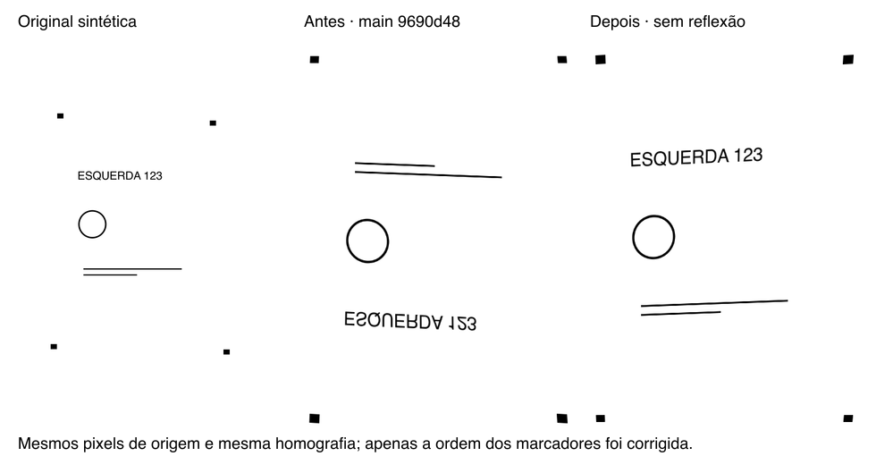

# Câmera OMR — fidelidade geométrica, 15/11/2026

Base: `main` em `9690d48`. Escopo exclusivo de captura/normalização. Não foram alterados banco, autenticação, Diário, Workers, D1, gabaritos, notas, cabeçalho, renderizador, layout, manifestos históricos ou amostragem/limiares do leitor OMR.

## Causas demonstradas

| Etapa | Reprodução na base | Correção |
|---|---|---|
| Guias da prévia | Vídeo 1920 × 1080 numa área 660 × 600: margem vertical de 114,375 px era adicionada duas vezes às guias de referência. `object-fit:contain` preservava os pixels; o deslocamento estava nas guias. | Coordenadas sempre no espaço intrínseco do vídeo; projeção única para a área útil do elemento, excluindo a borda. |
| Normalização | Vinte poses próximas de quatro marcadores: cinco resultaram em ordem refletida; outras alternaram 180°. Anéis direto/inverso tinham pontuação equivalente; ruído numérico decidia a orientação. | Somente sentido horário em coordenadas de imagem; desempate tolerante ao ruído numérico e início superior estável. A homografia e seus destinos físicos permanecem iguais. |
| Seleção de marcadores | Em cartões V1 densos projetados, componentes de texto/bolhas podiam ocupar o conjunto limitado de candidatos ou pontuar melhor que o marcador inferior. Isso gerava quadrilátero falso e deformação posterior. | Conservar candidatos fortes e próximos das quatro extremidades, total limitado a 32; exigir convexidade; pontuar a compatibilidade de área com os marcadores físicos já existentes de 5,5 mm e seus intervalos 194 × 281 mm. Valores de limiar do leitor e da detecção permanecem iguais. |
| Mudança de escala | A câmera detectava na prévia e voltava a escolher quatro pontos na captura maior, podendo trocar de quadrilátero. O limite de detecção antigo era apenas de largura: 1080 × 1920 virava 900 × 1600. | Maior dimensão limitada a 900 na detecção e 1800 na captura; reutilização dos mesmos quatro pontos, com escala em cada eixo e recusa explícita se a orientação mudar entre quadros. |



Arquivos estruturados: [guias](assets/camera-omr-20261115/guides-before-after.json), [vinte poses na base](assets/camera-omr-20261115/marker-order-before.json), [métricas sintéticas finais](assets/camera-omr-20261115/results.json).

Não foi demonstrado esticamento no `drawImage` antigo: ele já desenhava o quadro inteiro usando `videoWidth/videoHeight`. A nova conversão mantém essa propriedade. Não há evidência física suficiente para atribuir a distorção do iPhone à lente.

## Implementação

- `CameraSession` abre sem proporção obrigatória, enumera após permissão e prefere rótulos de câmera traseira principal frente a ultra, tele ou conjunto virtual identificado. “Wide/grande-angular” convencional não é tratado como ultrawide. A lista manual permite corrigir ambiguidades de rótulo; rótulo não comprova distância focal.
- Consulta `getCapabilities` antes de negociar limites ideais independentes até 2560 px; solicita `resizeMode:none` quando anunciado. O formato efetivo continua sendo o entregue pelo navegador. Falha de negociação mantém o stream inicial; a interface exibe `getSettings` e dimensões efetivas do vídeo.
- Zoom, exposição, foco contínuo e iluminação só aparecem quando anunciados pela câmera. Controles recusados mostram alternativa funcional; não são requisito para fotografar/importar.
- Troca, fechamento, cancelamento durante permissão, reinício, saída de página e término da track liberam os dispositivos. Respostas assíncronas antigas não encerram uma câmera mais nova.
- Prévia sem espelhamento ou recorte; canvas recebe o quadro inteiro na proporção intrínseca. Rotação reinicia a estabilidade. Guias são reprojetadas ao redimensionar a janela/vídeo.
- Captura automática exige enquadramento, área útil, iluminação, detalhe e estabilidade temporal, além dos marcadores. Reflexo é uma suspeita de região saturada em papel simultaneamente escuro, não a simples existência de papel branco. Mensagens curtas orientam o usuário. São heurísticas leves de pré-captura, não certificação de qualidade ou alteração da leitura de respostas.
- A fotografia manual permanece disponível; uma ordem manual refletida é recusada com mensagem e o ajuste dos quatro cantos continua acessível mesmo após uma normalização automática aparentemente bem-sucedida.
- `Ajustes da câmera` reúne seleção, recursos suportados e diagnóstico. Comparação mostra quadro original inteiro em cinza, reduzido a até 1800 px, e normalização A4 existente. Os pixels ficam na memória deste navegador. Nenhuma função nova envia imagens, telemetria ou dados de cartão.

## Diagnóstico óptico e comparações

[Padrão separado de calibração](assets/camera-omr-20261115/calibration.svg): 210 × 297 mm, marcadores de 5,5 mm, grade de intervalos 30 × 40 mm e círculo central de raio 10 mm. Não substitui nem modifica o cartão aprovado. Modo de diagnóstico desliga a captura/leitura automática para não interpretar o padrão como resposta.

A análise calcula desvio de posição e RMS de curvatura das linhas após retirar sua inclinação linear; informa energia de bordas relativa centro/extremidades. Indicadores em mm são referidos ao padrão digital normalizado. Impressão, tamanho real, papel curvo e desfoque também afetam o resultado; não atribuir automaticamente todo resíduo à lente.

Projeções sintéticas: perspectiva pura resultou em RMS máximo de **0,066 mm** e desvio máximo de **0,352 mm** usando os pontos conhecidos. A versão com distorção radial simulada manteve RMS de **1,084 mm** e desvio de **4,241 mm** após homografia. Isso demonstra que homografia não corrige lente. O coeficiente usado para gerar a fixture sintética pertence exclusivamente ao teste e nunca é aplicado a uma câmera.

**Nenhuma correção radial está habilitada ou perfil óptico armazenado.** Um perfil futuro exigirá dispositivo/lente/resolução/orientação identificados, medidas repetidas e melhora objetiva, aplicada igualmente à detecção e à captura.

## Testes e cobertura

- Suíte integrada: **108/108** testes; sintaxe dos módulos OMR e scripts inline válida; `git diff --check` limpo.
- Oito resoluções retrato/paisagem; arredondamento proporcional; conversão inteira vídeo/canvas; projeção das guias; mesmos pontos entre detecção/captura; rotação intermediária recusada.
- Permissão negada/API ausente; capacidades/controles não suportados; falha de negociação; preferência de câmera; stop, reinício e cancelamento de pedido tardio sem vazamento de tracks.
- Qualidade: papel válido, pouca luz, imagem sem detalhe, possível reflexo, movimento, folha distante e marcador junto à borda. Vinte poses estáveis e recusa de quadrilátero côncavo.
- Dez cartões de 10/20/50/100/150 questões em V1/V2, projetados em perspectiva, capturados a 1620 × 1800 e normalizados pelos pontos da prévia 810 × 900: C corretamente lido na primeira questão, restantes em branco.
- Regressão raster existente: 15 cartões a 300 DPI, PNG/JPG, 18 combinações de identificação/instituição/instruções, código sintético, marca dupla/fraca, logos em diversas proporções e transparência. Compatibilidade histórica e digests de geometria preservados.
- Chrome conectado no macOS: harness isolado com os mesmos controladores/DOM/CSS de câmera e `canvas.captureStream` sintético de 900 × 1000, resizeMode `none`. Abertura, captura automática/manual, análise, comparação e stop/restart exercitados. Viewports 1470 px e 390 px; versão móvel final sem overflow, largura do documento 390 px. Não equivale a câmera física nem Safari.
- CI executa o ensaio raster novo e anexa evidências, junto às regressões anteriores. Nenhuma fixture pessoal ou acadêmica é necessária.

Comandos:

```sh
node --test corretor/v2/tests/*.test.mjs stats-worker/tests/*.test.mjs plataforma/tests/*.test.mjs
SALTA_SHARP_MODULE=/caminho/sharp/dist/index.cjs node scripts/verify-card-artwork-raster.mjs
SALTA_SHARP_MODULE=/caminho/sharp/dist/index.cjs node scripts/verify-card-header-raster.mjs
SALTA_SHARP_MODULE=/caminho/sharp/dist/index.cjs node scripts/verify-camera-geometry.mjs
```

## Dispositivos e limitações específicas

| Ambiente | Configuração efetivamente observada | Limite da conclusão |
|---|---|---|
| Chrome/macOS conectado | Stream **sintético** 900 × 1000, canvas 900 × 1000 e normalizado 1400 × 1980; controles ausentes ocultados; câmera simulada encerrada/reaberta. | Nenhuma lente física medida. A consulta de hardware não forneceu configurações reais; não usada como prova de homologação. |
| iPhone 17 Pro/Safari informado pelo usuário | **Sem `getSettings/getCapabilities` ou fotografia real deste aparelho nesta execução.** | Causa física e configurações efetivas pendentes. Não declarar seleção comprovada de lente principal. |
| Safari/iOS | Suporte é consultado em execução. Sem determinada capacidade, o controle é omitido; sem acesso à câmera, importação continua disponível. | Não foi testado neste aparelho. Rótulos, controles, proporções e eventual câmera virtual dependem do que o navegador expõe. |
| Outros navegadores | Fallbacks testados por doubles, não por todos os motores. | Permissão/contexto seguro necessários. Sem capacidades ou identificação inequívoca de lente, não prometer foco/torch/zoom ou exclusão garantida de ultrawide. |

A seleção por `facingMode` é preferência, não certificado de lente. A [especificação W3C](https://www.w3.org/TR/mediacapture-streams/) distingue capacidades, constraints e settings e permite rotação das dimensões retornadas; a implementação usa os pixels efetivos do vídeo. Não é possível inferir o topo impresso com certeza absoluta só de quatro marcadores simétricos: posicionar o cartão na orientação indicada e conferir a prévia. A correção elimina reflexões e desempates instáveis; não introduz reconhecimento semântico de orientação.

## Homologação física pendente — iPhone 17 Pro/Safari

1. Abrir a versão pública atual em HTTPS, permitir câmera e entrar em Ajustes da câmera. Registrar versão do iOS/Safari, nome da câmera, resolução efetiva/configurada, facingMode e resizeMode mostrados, sem identificadores pessoais.
2. Baixar o padrão desta versão, imprimir em 100% sem ajustar à página e verificar com régua: 30 mm entre verticais, 40 mm entre horizontais, círculo com 20 mm de diâmetro. Papel plano e fosco.
3. Ativar o modo de diagnóstico; selecionar a traseira principal quando o rótulo permitir distinguir. Fotografar primeiro paralelo ao papel, com luz difusa, quatro marcadores e margens completos; repetir em retrato e paisagem, a diferentes distâncias adequadas ao foco, e com inclinação moderada.
4. Comparar original/normalizada. Retas convergentes que ficam retas após homografia indicam perspectiva; curvatura persistente requer separar lente, papel e impressão. Círculo elíptico sem perspectiva e intervalos desiguais podem indicar proporção incorreta. Observar a nitidez nas extremidades e a posição de cada marcador.
5. Repetir três capturas por condição e registrar os indicadores. Verificar que folha branca não é recusada como reflexo, que movimento/desfoque retêm captura automática com mensagem, e que fotografia manual permite correção explícita.
6. Só então ensaiar cartão sintético V1/V2 impresso, marcas simples/duplas/fracas, rotação e stop/restart. Confirmar leitura e revisão sem qualquer publicação de nota. Não usar alunos reais.

A correção de software pode ser publicada após CI/QA; **calibração física permanece pendente**. Reverter o PR desfaz somente código de câmera e diagnóstico, sem migração ou reversão de dados.
