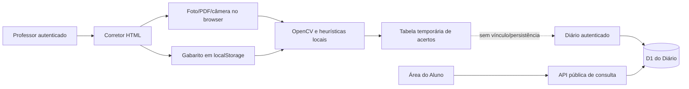

# SALTA — Auditoria e plano do Corretor OMR

**Fase:** 0 — auditoria e planejamento técnico
**Data:** 9 de novembro de 2026
**Repositório:** `d4nny3l/portal-do-aluno`
**Base publicada auditada:** `main` em `f4dce82716faa06720068f3228a6f890fd0f928f`
**Branch deste documento:** `codex/salta-corretor-v2-planejamento`

> Este documento é um plano, não uma especificação de algo já implementado. “Confirmado” significa observado no código ou em teste local; “não encontrado” significa que não existe no baseline auditado; “não verificado” significa que o recurso exige inspeção de serviço remoto ou evidência operacional que não foi acessada.

## 1. Resumo executivo

O Corretor publicado é uma página HTML independente, protegida pela sessão do professor, que gera um cartão A4 no navegador, recebe foto/PDF/câmera e tenta ler respostas com OpenCV.js. O professor informa um gabarito localmente. A correção e a tabela de acertos são temporárias na página; o único dado persistido pelo Corretor é o gabarito em `localStorage` (`saltaKey`). Não há criação de avaliação, roster, associação nominal, Código SALTA, resultado persistente, revisão auditável, integração com o Diário ou publicação na Área do Aluno.

O Diário já oferece cadastros, avaliações/itens, notas, vistos, frequência, relatórios e exportação; usa API autenticada no `stats-worker` e um binding D1 chamado `DIARIO_DB`. O banco de notas acadêmicas (`DB`) e o banco do Diário (`DIARIO_DB`) são bindings distintos no arquivo de configuração. Isso não comprova isolamento efetivo dos recursos Cloudflare: o banco chamado `salta-diario-teste` deve ser verificado no painel/conta antes de qualquer teste remoto. Nesta Fase 0 nenhum acesso remoto, consulta, gravação ou migração foi feito.

O SALTA Crypto Core está em uma branch e PR experimentais. Tem criptografia de cliente, repositório e Worker local para envelopes/ciphertext, além de testes sintéticos; não está ligado ao `salta-auth`, ao `stats-worker`, ao Diário publicado, nem à Área do Aluno. Não é base aprovada para armazenar dados reais. Integração segura de notas depende da resolução da identidade/autorização de estudantes, autenticação de membros, contratos de chave e fluxo de recuperação/revogação.

**Recomendação:** construir primeiro contratos e modelo de domínio com testes sintéticos, sem mudar o Diário. Fixar identidade de avaliação, participante, cartão e revisão; versionar template/gabarito; definir integração criptográfica como bloqueio arquitetural; depois validar o OMR em corpus rotulado antes de lançar nota. O plano abaixo organiza esse percurso em fases pequenas. Nenhuma funcionalidade foi implementada nesta entrega.

## 2. Escopo, proteção e estado do Git

- O prompt mestre `SALTA_CORRETOR_PROMPT_MESTRE.md` foi lido integralmente. Os requisitos 1–65 são rastreados individualmente na matriz deste documento; os 12 controles adicionais de segurança/confiabilidade têm uma matriz própria.
- O baseline de auditoria é `main` remoto em `f4dce827…`, conferido no GitHub. O trabalho foi iniciado em worktree separado, em `codex/salta-corretor-v2-planejamento`, a partir desse commit.
- O checkout compartilhado `repository/` está em `main` local `4724e867…`, atrás da referência remota observada, e contém mudanças não publicadas em páginas, Workers, tema e artefatos do Corretor, além de `.wrangler/` e arquivos temporários. Ele não foi alterado, limpo, restaurado ou usado para publicar. `.wrangler/` e temporários não foram lidos.
- A diferença local de `corretor/index.html` foi inspecionada apenas como comparação: inclui cartão EJA, alterações de coordenadas do modelo e tema que não existem no baseline remoto auditado. Não foi incorporada a este PR; a documentação descreve primeiro o baseline publicado e identifica a divergência como trabalho local não publicado.
- O PR #4 (`codex/salta-e2ee-implementacao`) foi observado como draft, aberto e sem merge, com destino `main`. O plano não depende de merge automático desse PR.
- Nenhum Worker, secret, D1, dado de produção ou GitHub Pages foi alterado. A publicação pretendida para esta entrega é somente deste Markdown numa branch e PR draft.

## 3. Inventário técnico e recursos reaproveitáveis

| Área | Estado confirmado no baseline | Reuso e limite para o Corretor |
|---|---|---|
| Corretor | `corretor/index.html`: UI e lógica inline; cartão A4 canvas variável de 1–50 questões; gabarito A–E; importação de imagem/PDF até 8 páginas e 25 MB; captura de câmera; OpenCV.js; leitura de cartão SALTA e modelo legado fixo 20 questões. | Reusar identidade visual, geração A4, abertura de arquivos, captura, perspectiva/fiduciais, amostragem e apresentação inicial. Extrair módulos isolados e testar antes de substituir o HTML monolítico. Não reusar o gabarito em localStorage como persistência de produção. |
| Cartão estático | `corretor/folha-resposta.html`: arte A4 fixa, com campos de cabeçalho e grade antiga. | Reconhecimento legado deve ser versionado; o arquivo pode permanecer disponível para arquivos impressos já distribuídos. Não tratar coordenadas do legado como um template universal. |
| Área do Professor | `plataforma/professor.html`: sessão por cookie, Turnstile no login, tema/sidebar e link para Corretor/Diário. | Reusar shell, navegação e integração de sessão. Hoje a autenticação representa uma conta de professor; não modela membros, instituição, papéis ou autorização por turma. |
| Diário | `plataforma/diario-teste.html`: carregamento autenticado, CRUD de turmas/alunos/itens, lançamentos, frequência e relatórios; `stats-worker/worker.js` implementa rotas `/diario/*`. | Reusar IDs e operações de turma/aluno/avaliação somente através de contratos autorizados. O Diário atual não conhece cartões OMR, snapshots da prova, tentativas, revisão ou estado provisório. |
| Dados do Diário | `DIARIO_SCHEMA` em `stats-worker/worker.js` cria classes, alunos, itens, registros, bimestres, horários e frequência. Valores de notas/nomes são armazenados em claro no D1 atual. | O novo desenho não deve gravar respostas/fotos/gabaritos/notas em claro como atalho. E2EE exige mudança de contrato no cliente do Diário e portal do aluno, com plano de coexistência e migração separado. |
| Auth | `auth-worker/worker.js`: login com Turnstile, limites de tentativa, Durable Object para sessões, cookie HttpOnly/Secure/SameSite e verificação de sessão; `stats-worker` faz proxy `/auth/*` e verifica sessão nas rotas protegidas. | Reusar verificação de sessão server-side. A autorização atual é de professor único e não prova escopo tenant/turma; não usar ID enviado pelo browser como autorização. Código de estudante de 7 dígitos não pode autenticar nem autorizar consulta. |
| Área do Aluno | `preview-aluno.html`: consulta pública protegida por fluxo próprio e exibe notas/avaliações/avisos da API pública. | O Corretor deve publicar somente nota definitiva autorizada e compatível com este contrato. O portal hoje espera valores em claro da API; integração E2EE está bloqueada até desenho de identidade/chaves e renderização no cliente. |
| Tema | `salta-theme.css`, `plataforma/professor-theme.css`, shell em `plataforma/professor.html`. | Reusar quadriculado, cartões, sidebar e estados do tema. Garantir fundo quadriculado fixo sem transparência ilegível, foco visível, teclado e `prefers-reduced-motion`. |
| Crypto Core | `security/crypto`, `security/storage`, `security/access`, `crypto-lab/worker.js`, migração local e demo sintética na branch E2EE. | Reusar contratos após revisão; nunca reutilizar o Worker local como serviço hospedado. Core não autentica contas SALTA nem verifica a origem da chave pública com Auth real. |
| Testes/workflows | `stats-worker/tests/diario-periods.test.mjs` testa erro/persistência de bimestres com SQLite em memória e mock Auth. O workflow E2EE roda apenas em paths E2EE; workflows de deploy são separados. | Expandir suítes unitárias sintéticas e CI específica do Corretor. Não usar os testes atuais como prova de OMR, isolamento Cloudflare ou E2EE produtivo. |

### Observações confirmadas do OMR atual

- `questionCount` e inferência de questões limitam o produto a 50; a detecção compatível fixa grade legada em 20 questões.
- O caminho novo identifica quadrados/fiduciais, retifica perspectiva e mede marca com heurísticas. O resultado classifica resposta como `?` quando a diferença entre bolhas fica abaixo de `0.055` ou `0.025`; esses limiares não estão acompanhados de corpus, calibração ou métricas de falso positivo/falso negativo no repositório.
- O PDF tem limite de 8 páginas/25 MB e carrega `pdfjs-dist@4.10.38` de CDN fixa; OpenCV é carregado de `https://docs.opencv.org/4.x/opencv.js`, sem versão fixa no URL. São dependências de execução remota no browser e precisam de pinning/revisão de integridade e estratégia de indisponibilidade.
- A lista de respostas vem de PDF/arquivo local ou câmera e a análise ocorre no browser. O código atual não envia essas imagens ao Worker. Isso descreve o código; não é garantia contra extensão, script/CDN comprometido, captura de tela, memória ou exportação local.
- `saltaKey` é lido de `localStorage` via JSON e depois valores são interpolados em `innerHTML` ao montar resultado. Como storage do navegador pode ser adulterado por script/extensão/outra página da mesma origem, o valor precisa ser validado e renderizado por APIs seguras antes de usar essa superfície com resultados. Este é um risco de código confirmado, não evidência de exploração.
- A câmera é encerrada ao fechar o componente; não foi encontrado tratamento explícito de `pagehide` para interromper as tracks se a página for abandonada durante a captura.

## 4. Fluxo atual e limites

O sistema já autentica a abertura de módulos de professor, mas a correção atual não persiste por cartão e não transmite resultado para o Diário. A tabela temporária mostra “acertos”, não uma nota calibrada para pesos, questões anuladas, tipos de item ou critérios. Não existe lista do que ficou sem ler além da indicação para revisar; o fluxo não distingue ausência, questão anulada, reescaneamento de uma mesma folha e segunda chamada.

## 5. Arquitetura alvo proposta

### 5.1 Limites e componentes

1. **Aplicação web SALTA**: shell do Professor/Diário e rotas do Corretor; módulos JS separados para domínio, templates, captura, leitor, revisão, acessibilidade e adaptadores. A UI não calcula permissão nem decide identidade confiando em parâmetros do browser.
2. **Domínio de avaliação versionado**: avaliação, instruções/cabeçalho, participantes snapshot, seções, questões, pesos, chave, regras de anulação, versão de prova e modelo de cartão. Mudança cria revisão imutável nova; nunca sobrescreve a versão usada por cartões já aplicados.
3. **Pipeline OMR no cliente**: valida o arquivo, corrige orientação/perspectiva, detecta versão/marcas, retorna leituras com confiança e qualidade por item; imagem não sai do dispositivo por padrão. Nenhuma leitura duvidosa vira resposta definitiva automaticamente.
4. **API Worker**: autentica sessão por serviço Auth; autoriza ação para tenant, turma e avaliação em cada requisição; valida estado e versão; fornece idempotência, revisão otimista e trilha mínima de auditoria. Rejeita IDs/tenant arbitrários sem membership autorizada.
5. **Persistência E2EE**: ciphertext de cabeçalho, roster, gabarito, respostas, imagem se guardada, notas e histórico. D1 armazena envelopes/ciphertext e metadados opacos estritamente necessários. Dado pessoal não deve entrar em logs, URLs, métricas ou erros. Não criar endpoint plaintext enquanto E2EE estiver bloqueado.
6. **Adaptador Diário**: converte uma revisão definitiva validada em nota de avaliação por aluno/avaliação, com chave de idempotência por resultado. A interface docente e do aluno abre a mesma informação localmente sob escopo e grants. Escrever no diário e marcar sincronização precisam ser uma operação idempotente/recuperável, não uma promessa de “salvo” otimista.
7. **Análise pedagógica local**: calcula indicadores após descriptografar no cliente. Métricas derivadas por turma também podem reidentificar estudantes; não devem ser enviadas a serviço de analytics sem política e limiar de grupo.

### 5.2 Identidade e isolamento

- Separar `person_id` opaco global, `tenant_id`, associação/matrícula `enrollment_id`, `class_id`, papel e permissão. Uma pessoa pode ter memberships distintas; mudar escola/turma não recria a identidade.
- Código SALTA de 7 dígitos é identificador de cartão, não credencial, segredo, chave de cifra nem autorização. Gerar com `crypto.getRandomValues`, manter único em escopo global por índice/constraint, colisão resolvida com retry transacional; permitir zeros à esquerda e nunca reutilizar. 10 milhões de códigos não resistem a enumeração.
- A associação entre código e aluno só é resolvida após autenticação/autorização contextual, sem busca global pública. Proteger contra correlação entre tenant, escola, turma e ano. Compatibilidade/migração de códigos legados é fase futura, sem execução agora.
- Para cartão, guardar `assessment_id` opaco e versões de template/prova; QR opcional contém apenas token aleatório não enumerável, sem nome/código/ID interno, e ainda requer que o Worker confirme autorização e pertença ao evento.

### 5.3 Modelo lógico conceitual

O modelo abaixo é conceitual, sem migração proposta para o D1 atual. Conteúdo sensível deve ser cifrado no cliente em objetos autenticados por escopo e versão (AAD/contexto), conforme o contrato que vier a ser aprovado.

| Entidade | Campos/metadados mínimos sugeridos | Regra de integridade |
|---|---|---|
| `tenant` / `membership` | IDs opacos, chave pública verificada, papel, estado, época de chave | Isolamento por tenant; grant revogável no Worker; chave vinculada à identidade autenticada. |
| `person` / `enrollment` | `person_id` opaco; dados acadêmicos cifrados; tenant/ano/turma; código OMR cifrado ou token opaco | Identidade global separada do vínculo escolar; código único sem função de login. |
| `assessment` | `assessment_id`, tenant/class opacos, status, revisão corrente, período | Prova sempre ligada a turma/período e permissão; fechamento não edita snapshot passado. |
| `assessment_revision` | `revision_id`, versão de schema, ciphertext de título/cabeçalho/regras | Imutável; mudança cria nova revisão e fluxo explícito de republicação. |
| `participant_snapshot` | `snapshot_id`, referência cifrada a enrollment e dados mínimos de impressão | Congela roster no momento de aplicação; novos alunos/ordem atual não alteram folha aplicada. |
| `question` / `answer_key_revision` | IDs/ordem/tipo/opções/peso/alternativas, anulada e regra de nota, cifrados | Chave imutável versionada; alteração exige preview, confirmação e recálculo auditável. |
| `template_revision` | dimensões, fiduciais, áreas, opções, DPI/tolerância, hash do render e versão do leitor | Compatibilidade explícita; nunca inferir layout por coordenadas mutáveis sem identificar versão. |
| `card` / `card_occurrence` | token opaco, revisão do cartão, estado, tentativa/ocorrência | UNIQUE de idempotência do resultado por assessment+participant+attempt; re-scan cria evento, não nota duplicada. |
| `capture_page` | ciphertext da imagem se política permitir; page index, orientação/qualidade | Retenção mínima, prazo, consentimento/base institucional; purge verificável. |
| `answer_observation` | ciphertext de leitura, score de confiança, qualidade e origem do leitor | Leituras ambíguas ficam pendentes; não sobrescrevem decisão humana. |
| `adjudication` | item revisado, decisão, ator autorizado, revisão, motivo e timestamp | Append-only; preservar leitura original e correções. |
| `result_revision` | ciphertext de nota, status provisório/definitivo, versão da chave, hash de conteúdo | Cálculo determinístico; publicar só definitivo e com confirmação do Worker. |
| `diary_outbox` | ID idempotente, resultado/revisão, estado de sincronização | Retry sem duplicar nota; confirmar depois de resposta autoritativa. |
| `audit_event` / `key_registry` | eventos mínimos, referência de chave/época, ciphertext | Sem PII/notas em logs; trilha de revisão sem fingir que ciphertext/backups foram apagados ao remover uma chave. |

Evitar armazenar imagem original por padrão. Se necessária para revisar, estabelecer finalidade, duração, acesso, exportação e descarte aprovados; apagar uma linha ou destruir uma chave não prova a eliminação de cópias/backups.

### 5.4 Contratos de módulo propostos

Os exemplos abaixo são propostas para mock/staging sintético; não são rotas existentes.

| Integração | Contrato desejado | Bloqueio / aceite |
|---|---|---|
| Diário | `GET /diario/avaliacoes?turma&bimestre`; `POST /diario/avaliacoes` para vínculo de assessment; `PUT /diario/resultados/{opaqueId}` com `expected_revision`, `idempotency_key`, estado e ciphertext; consulta das revisões/resultados por grant. | Atual API `/diario/itens` e `/diario/notas` grava valores em claro. Não conectá-la ao OMR até o Diário aceitar envelope E2EE e operações de conflito/idempotência, ou até haver decisão explícita de arquitetura que resolva o requisito E2EE sem atalho plaintext. |
| Área do Professor | abrir avaliação a partir da turma e período selecionado; criar e editar revisão; corrigir, revisar leituras e publicar com confirmação. | Sessão atual autentica professor mas sem multi-tenant/escopo por instituição ou papel. Worker deve calcular autorização a partir da sessão e membership. |
| Área do Aluno | consultar nota publicada e gabarito liberado quando aplicável; histórico por bimestre; nenhuma imagem/rascunho/revisão interna. | Consulta atual é pública com código de aluno + anti-bot e respostas em claro. Código de 7 dígitos não pode substituir a autenticação/controle de acesso; definir identidade de aluno e UX de recuperação antes da integração. |
| Auth Worker | identidade autenticada estável, sessão rotativa, tenant membership, papel, vínculo chave pública autenticado e revogação; nenhuma chave privada no servidor. | Hoje existe usuário/senha de professor e sessão DO, sem identidade multiusuário institucional nem credenciais de estudante. Não colocar E2EE em produção até contrato de chave verificada e recovery aprovado. |
| SALTA Crypto Core | adapter de objeto cifrado: seal/open, AAD com tenant/scope/object/version, envelope/grant, revisão otimista e rekey; tipos de objeto do Corretor. | E2EE é laboratório local-only, sem Auth real, sem revisão independente, sem integração com os workers produtivos, sem multi-device/recovery completo e sem homologação remota. Usar mock para fluxo, sem armazenar dados reais. |

### 5.5 Contratos de APIs novos (a desenhar, não implementar nesta fase)

Rotas futuras devem seguir namespaces de recurso e validação de autorização. Cada mutação carrega `request_id` gerado no servidor, chave de idempotência e revisão esperada; resposta não deve incluir dados além do escopo autorizado. Uma resposta `202` significa pendente, não publicada. Persistir metadados de operador mínimo e nunca logar payload, imagem, gabarito, token, nome ou nota.

- Criar avaliação: valida tenant/turma/período, cria `assessment_id` opaco e revisão 1 com ciphertext.
- Salvar gabarito/template: cria revisão imutável, verifica formato/versão, retorna revisão e impressão derivada; nunca altera cartões emitidos.
- Criar roster snapshot/cartões: confirma participante autorizado da turma, gera token aleatório e associação cifrada; unique e expiração/revogação conforme o ciclo da avaliação.
- Registrar leitura: recebe observações cifradas por cartão/revisão e estado `needs_review`; mesma idempotency key retorna a mesma ocorrência, duplicata de captura registra ocorrência separada sem publicar nota duas vezes.
- Adjudicar/recalcular: exige permission, `expected_revision`, motivo e confirmação; grava nova decisão e recalcula a nota determinística sob a nova versão da chave.
- Publicar/sincronizar no Diário: somente `definitive`; operação atomicamente idempotente do ponto de vista observável, reprocessável após timeout e não declara sucesso antes de confirmação.
- Descartar/exportar: operação contextual, reautenticada quando sensível, com prévia/confirm e registro mínimo do resultado sem preservar o conteúdo descartado em logs.

## 6. Fluxos UX previstos

1. **Dashboard do Corretor:** ações “Criar avaliação”, “Minhas avaliações”, “Corrigir cartões”, “Revisões necessárias”, “Modelos de cartão”, “Cabeçalhos” e “Análise Pedagógica”, com turma/período visível e contexto autenticado. Reusar navegação da Área do Professor.
2. **Criação:** selecionar turma e período do Diário; título, data, critérios, tipo de questão, opções/seções, pesos, regra de nota e roster; salvar como rascunho; validar; publicar versão para aplicação. Edição após aplicação cria nova revisão e pergunta impacto.
3. **Modo automático:** gerar cartões com identificador opaco/QR sem PII; impressão ou folha integrada; capturar em lote, mas persistir cada cartão individualmente; mostrar fila e reconciliação de duplicatas.
4. **Modo nominal:** escolher aluno já vinculado à turma; gerar cartão pré-associado ou resolver associação após autenticação/contexto. Nunca permitir mapear código apenas por busca pública.
5. **Cabeçalho:** pessoal ou institucional conforme tenant; instituição selecionada, campos permitidos e preview; sem inferir escola do browser. Separar dados que serão impressos dos metadados internos.
6. **Correção e revisão:** mostrar qualidade de imagem e respostas por item, com estados “lida”, “em dúvida”, “em branco”, “dupla”, “anulada”; professor resolve divergências. Nota provisória mostra intervalo possível e impede sincronização automática.
7. **Reescaneamento:** oferecer “mesmo cartão/mesma tentativa” ou “nova tentativa/segunda chamada”; exigir confirmação; preservar captura/análise anteriores e impedir duplicata de nota.
8. **Publicação:** preview do resumo, turma, alunos, chave/revisão e notas; mostrar pendências e ausências; professor confirma publicação; estados de rede/sync devem diferenciar local, pendente, sincronizado e falha.
9. **Análise pedagógica:** filtros por período, turma, avaliação, questão, faixa, habilidade e versão de prova; métricas calculadas localmente, com definição do denominador e tratamento de ausentes/anuladas; exportação local avisando que o arquivo contém dados.
10. **Acessibilidade/desempenho:** leitura mobile com poucos toques, captura por teclado/leitor de tela sem depender de cor, controle de zoom, mensagens acionáveis, tabela responsiva; editor e análise em desktop; redução de animação; lazy loading e limites de arquivo explícitos.

## 7. Regras determinísticas de correção

Formalizar antes de implementação, com exemplos e matemática em testes de referência:

- Tipos: A–D, A–E, Certo/Errado e seções mistas por versão; ordem e número de questões imutáveis na aplicação.
- Acerto/erro/branco/dupla/ambígua são estados diferentes. Marca ambígua/múltipla não vira zero definitivo sem política e revisão; faixa mínima/máxima de nota acompanha pendências.
- Questão anulada exige regra configurada: conceder peso a todos ou retirar questão e renormalizar; registrar a escolha, autor, data e revisão. Alterar gabarito recalcula toda pessoa afetada numa nova revisão com preview e confirmação.
- Ausente não é nota zero automática; ausência, segunda chamada, incompleta e cartão não recebido não devem ser confundidos com cartão em branco.
- Pontuação ponderada e arredondamento definidos por prova/Diário com precisão e momento explícitos; teste de fronteira decimal, peso, soma e zero questões válidas.
- Resultado `provisional` se existe leitura/revisão pendente; `definitive` somente após revisão de todas as questões aplicáveis, validação e publicação expressa. Resultados definitivos que mudarem têm novo histórico e atualização do Diário rastreável.
- Re-scan preserva captura/origem original, associa a ocorrência/attempt e atualiza somente conforme política de idempotência. Nova chamada é attempt distinta, nunca confundir com retry técnico.

## 8. Validação OMR e qualidade de impressão

O leitor atual é heurístico, não há desempenho medido que permita afirmar precisão. Antes de usar nota real:

1. Definir formatos/cartões identificados por `template_revision`, versões antigas e layout integrado/separado; validar 1–100 questões em múltiplas páginas, A–D/A–E/C-E e composição mista. O prompt pede montagem 1–100, embora a UI atual aceite até 50.
2. Criar dataset sintético gerado pelo render oficial e dataset de fotos consentidas/anonimizadas e rotuladas. Separar por cartão/impressora/câmera no train/calibration/test para impedir vazamento de duplicatas. Sem imagens reais de alunos nesta etapa.
3. Variar resolução/DPI, escala de impressão, rotação, perspectiva, corte, sombra, brilho, papel, marca fraca, caneta colorida, rasura, duplas, em branco e interferência de texto/quadriculado. Garantir espaço para A4, margem e registro de escala.
4. Medir por classe e por condição: exatidão por bolha e questão, taxa de `ambiguous`, falso acerto, falso erro, falso branco, false positive/negative, taxa de revisão manual e desempenho por aparelho/impressora. Publicar matriz de confusão e intervalos de confiança antes de escolher threshold.
5. Testar em navegadores/alvos e dispositivos definidos; limitar memória e tempo de processamento, cancelar operação, liberar `cv.Mat`, câmera e URLs temporárias, e lidar com arquivo corrompido, grande, PDF protegido, timeout/CDN offline e 0 páginas reconhecidas.
6. Critério inicial recomendado: falso acerto/erro automático não ambíguo deve tender a zero em corpus de homologação com limite superior estatístico acordado; todas as condições fora de calibração permanecem em revisão. O número de amostras/limites finais é uma decisão aberta; não inventar um “99%” sem corpus suficiente.
7. Validar impressão física a 100% (sem “ajustar à página”), grayscale e colorida, modelos suportados, recorte e versão de template. Incluir instruções simples de enquadramento e botão para corrigir manualmente.

## 9. Matriz dos 65 requisitos originais

Status: **Parcial** = há infraestrutura ou UI aproveitável, mas não entrega o requisito; **Ausente** = não encontrado no baseline publicado; **Presente** = observado com escopo limitado. O aceite é critério futuro, não teste já passado.

| # / requisito | Estado real hoje | Risco principal | Fase | Critério de aceite futuro |
|---|---|---|---|---|
| 1. Contexto atual | Parcial: módulos e dados existem, Corretor isolado. | Reimplementar/regravar algo existente ou quebrar módulo. | 0–1 | Inventário e contratos aprovados; regressão nos fluxos publicados. |
| 2. Corretor ligado ao Diário | Ausente. | Nota sem turma, período ou vínculo consistente. | 1, 4 | Avaliação criada no Diário e resultado definitivo integrado uma só vez. |
| 3. Workspaces pessoal/instituição | Ausente; sessão de professor único. | Vazamento entre escolas/turmas. | 1, 5 | Testes negativos multi-tenant e memberships simultâneas. |
| 4. Código permanente de 7 dígitos | Ausente no Corretor. | Colisão/enumeração e identidade incorreta. | 1 | Geração CSPRNG, UNIQUE, retry de colisão; teste de zeros/limites. |
| 5. Código como identidade acadêmica | Parcial: portal tem códigos legados, sem vínculo OMR. | Confundir identificador público com autenticação. | 1, 5 | Vínculo persistente separado de login; consulta sem código não autorizado. |
| 6. Códigos antigos | Não há migração específica para OMR. | Perda de vínculo histórico. | 5–6 | Plano opt-in, mapa verificável e rollback ensaiado em cópia sintética. |
| 7. Modos automático e nominal | Ausente; só leitura local de cartão. | Fluxos de identificação incompatíveis. | 2, 4 | Ambos geram cartão/revisão equivalente, sem duplicar pessoa. |
| 8. Identificação no cartão | Ausente; sem participante/token por cartão. | Cartão atribuído ao aluno errado e QR com PII. | 2 | Token opaco versionado; sem PII legível; autorização no Worker. |
| 9. Participantes da avaliação | Ausente; sem snapshot do roster. | Mudança posterior na turma altera cartão histórico. | 1–2 | Snapshot imutável com roster da aplicação e teste de mudança de turma. |
| 10. Aluno não identificado | Ausente. | Perder cartão ou associar por inferência. | 4 | Estado não identificado em quarentena; associação manual autorizada auditada. |
| 11. Criação da avaliação | Ausente; gabarito não é avaliação. | Resultado sem data, turma, valor ou estado. | 2 | Rascunho/publicação e validação ligados a turma/período. |
| 12. Tipos de questão | Parcial: somente alternativas A–E. | Não representar C/E, A–D ou seções mistas. | 2 | Render/OMR/cálculo testados em cada tipo e versão mista. |
| 13. Resposta correta | Parcial: gabarito local A–E. | Resposta sem histórico/autor/versionamento. | 2 | Chave cifrada e imutável com versão e auditoria de alteração. |
| 14. Valor da avaliação | Ausente como nota ponderada; exibe contagem de acertos. | Contagem não equivale à nota configurada. | 2, 4 | Fórmula documentada e casos de peso/arredondamento aprovados. |
| 15. Questão anulada | Ausente. | Recalcular sem regra ou alterar silenciosamente nota. | 2, 4 | Opção de anulação explícita, preview, nova revisão e testes. |
| 16. Alteração do gabarito | Ausente; só muda localmente. | Resultado histórico inconsistente. | 4 | Nova revisão recalcula afetados, apresenta diff e sincroniza idempotente. |
| 17. Aluno que não realizou | Ausente. | Ausência confundida com branco ou zero. | 4 | Estados separados; ausência não gera zero automaticamente. |
| 18. Publicação imediata | Ausente. | Notas provisórias publicadas sem revisão. | 4 | Confirmação explícita; somente definitivo chega ao Diário/Aluno. |
| 19. Questões duvidosas | Parcial: “?” visual pede revisar, sem workflow persistente. | Leitura equivocada torna-se nota. | 3–4 | Fila de revisão com confiança, decisão humana e histórico da leitura. |
| 20. Área do Aluno | Existe área de consulta; sem integração OMR. | Exposição de rascunhos/identidade. | 4–5 | Apenas dados autorizados e publicados; testes de escopo/privacidade. |
| 21. Gabarito para o aluno | Ausente como publicação de prova. | Liberação antes da hora/versão errada. | 5 | Regra de liberação por avaliação, versão e público testada. |
| 22. Reescaneamento | Parcial: pode carregar arquivo novamente, sem idempotência. | Duplicação ou sobrescrita silenciosa. | 4 | Re-scan é ocorrência; uma nota por attempt e retry seguro. |
| 23. Construtor de cartão | Parcial: canvas dinâmico 1–50 e folha fixa legada. | Não suporta 51–100, versões/aplicação integrada. | 2 | A4 1–100, multipágina, cartão separado/integrado e revisão reconhecida. |
| 24. Editor visual | Ausente como editor por blocos; só gabarito simples. | Professor sem controle sobre layout/questões. | 2 | Editor por blocos acessível com preview e persistência de versão. |
| 25. Cabeçalho pessoal | Ausente no construtor atual. | Repetição manual e dados não contextualizados. | 2 | Cabeçalho editável por professor, impressão versionada, sem mudar avaliação. |
| 26. Cabeçalho institucional | Ausente. | Mistura de identidade escolar/workspace. | 2 | Perfil institucional com permissão e template isolado por tenant. |
| 27. OMR | Parcial: OpenCV/fiduciais/heurística no browser. | Limiares sem evidência e erros automáticos. | 3 | Corpus rotulado, calibração, métricas e nenhuma ambiguidade auto-publicada. |
| 28. Captura | Parcial: imagem/PDF/câmera local. | Limites, leaks, permissão e disponibilidade de CDN. | 3 | Testes de arquivos, orientação, mobile, limpeza de recursos e dependências fixas. |
| 29. Aba de revisão | Ausente como registro/tela persistente. | Pendências invisíveis ou correção não auditável. | 3–4 | Fila persistida filtrável por classe, tentativa e estado, com trilha. |
| 30. Análise Pedagógica | Ausente no Corretor. | Métricas precipitadas sem regra definida. | 5 | Métricas documentadas e calculadas no escopo autorizado. |
| 31. Filtros | Ausente no Corretor. | Consulta ampla revela turma/aluno. | 5 | Filtros tenant/turma/período/avaliação autorizados e sem enumeração. |
| 32. Dados da análise | Ausente. | Denominadores/ausências mal definidos. | 5 | Indicadores definem universo, faltantes, anuladas e versões. |
| 33. Gráficos | Ausente no Corretor. | Gráfico inacessível ou enganoso. | 5 | Tabelas equivalentes, labels e teclado, verificação de valores. |
| 34. Análise avançada futura | Ausente. | Inferência excessiva sobre estudante. | 5+ | Só após validação dos dados, finalidade e revisão de privacidade. |
| 35. Versões de prova | Ausente. | Atribuir gabarito de versão errada. | 2–4 | Folha identifica versão não pessoal; chave e scoring coincidem no teste. |
| 36. Ciclo de vida dos dados | Ausente no Corretor. | Retenção indefinida e apagamento ambíguo. | 5 | Estados, prazos, backup e descarte documentados e testados. |
| 37. Criptografia | Core experimental separado; Corretor local. | Tratar login/localStorage como E2EE. | 1, 5 | Threat model, chave autenticada, ciphertext em rede/D1 e teste sem plaintext. |
| 38. Descarte de dados detalhados | Ausente. | Guardar imagem/resposta sem finalidade. | 5 | Retenção mínima, exportação, descarte e prova operacional aprovados. |
| 39. Crypto-shredding | Não implementado para dados reais. | Alegar apagar cópias/backups ao destruir chave. | 5–6 | Rotação/revogação documentadas; cópias e limites descritos e verificados. |
| 40. Fechamento do Diário | Diário tem dados e fechamento em desenvolvimento; sem snapshot OMR. | Fechar antes de sincronizar resultados. | 4–5 | Snapshot inclui avaliações OMR e reconciliação; reopen controlado. |
| 41. Experiência visual | Tema SALTA e shell existem. | Inconsistência no novo fluxo e acesso. | 2–5 | Revisão visual em desktop/mobile e regressão de quadriculado/sidebar. |
| 42. Referência de UX | Princípios do projeto descritos, sem módulo novo. | Copiar padrão de terceiros ou sobrecarregar professor. | Todas | Avaliação observada com poucos cliques, sem copiar código proprietário. |
| 43. Dashboard Corretor | Ausente. | Acesso difícil e fila sem prioridade. | 2 | Entradas para criar, corrigir, revisar, modelos, cabeçalhos e análise. |
| 44. Dashboard contextual | Ausente. | Professor corrige turma/período errado. | 2 | Contexto/turma/período sempre visíveis e confirmados antes de lançar. |
| 45. Princípio de usabilidade | Parcial: UI simples, mas não integrada. | Erro operacional/duplicação por fluxo fragmentado. | Todas | Tarefas críticas testadas com professor; estados claros e recuperáveis. |
| 46. Mobile first | Captura existe; não há testes móveis documentados. | Fotos/controles inviáveis na sala. | 3 | Cenários em dispositivos definidos, poucos toques e leitor acessível. |
| 47. Desktop first | Configuração básica sem editor. | Configuração extensa não manejável. | 2 | Editor/teste teclado, escala e navegação por viewport ampla. |
| 48. Diário eletrônico | Presente com turma, itens, notas, relatórios e frequência. | Contrato atual grava plaintext. | 1, 4 | Interface preservada e avaliação OMR aparece como item/versionamento autorizado. |
| 49. Frequência | Presente no Diário. | Regressão ou acoplamento indevido com leitura. | 4+ | Testes de não regressão no fluxo existente; OMR não altera frequência. |
| 50. Atividades e vistos | Presentes no Diário. | Mistura de componentes e cálculo. | 4+ | Testes garantem que OMR só afeta avaliação alvo. |
| 51. Integração Corretor → Diário | Ausente. | Nota duplicada, falsa confirmação, quebra de notas. | 4 | Resultado definitivo, idempotência e reconciliação comprovadas com D1 isolado sintético. |
| 52. Histórico | Ausente no Corretor. | Perder original e quem alterou. | 4–5 | Snapshot de roster/chave/leitura/publicação; eventos append-only. |
| 53. Confiabilidade | Parcial: mensagens de erro na UI; sem persistência/retry de resultado. | Perda durante queda e “salvo” prematuro. | 3–4 | Fault injection, idempotência, retry/reload e estado de sincronização corretos. |
| 54. Offline e instabilidade | Arquivo processado local, sem fila de resultados. | Perda/duplicação e armazenamento local inseguro. | 4 | Fila cifrada, expiração e reconciliação; se crypto não aprovado, offline não armazena PII. |
| 55. Privacidade | Fotos não são enviadas pelo código atual; gabarito em localStorage. | Script/CDN e XSS; falta política de retenção. | Todas | Threat model, minimização, logs sem dados, política institucional e testes de rede. |
| 56. Banco de testes | Não há corpus OMR publicado encontrado. | Qualidade impossível de medir. | 3 | Corpus sintético versionado e fixture rotulada consentida sem PII. |
| 57. Testes OMR | Ausentes no baseline. | Erro de marca não detectado. | 3 | Matriz de confusão e ensaios por cenário/aparelho/impressora. |
| 58. Testes de carga | Ausentes para Corretor. | Memória/tempo em lotes grandes. | 5 | Tamanho máximo, lote concorrente e orçamento de tempo/memória verificados. |
| 59. Implementação em etapas | Especificação pede etapas; ainda não plano detalhado. | Refazer arquitetura ou liberar etapa insegura. | 0 | Sequência e gates definidos neste documento e aprovados antes da Fase 1. |
| 60. Primeiro passo do Codex | Fase 0 solicitada agora. | Implementação prematura. | 0 | Auditoria entregue; nenhuma feature alterada nesta etapa. |
| 61. Preservação do projeto | Worktree separada; checkout principal sujo preservado. | Perder alterações não publicadas. | 0 | Diff da branch contém somente documentação; worktree local intacta. |
| 62. Publicação | Requisito desta execução: branch + PR draft documental. | Publicar feature/deploy sem aprovação. | 0 | Commit e PR draft revisados, sem merge/deploy/D1. |
| 63. Não fazer | Restrições explícitas no prompt. | Uso de dado real/plaintext, migração ou cópia de terceiro. | Todas | PR e fases respeitam lista de proibições; revisão de diff antes de publicar. |
| 64. Critério de sucesso | Definido pelo produto, não medido no estado atual. | Declarar sucesso antes de estabilidade/segurança. | 6 | Gates de UX, OMR, privacidade, integração e rollback todos aprovados. |
| 65. Princípio final de produto | Diretriz “um diário feito de professor para professor”. | Complexidade e cliques desnecessários. | Todas | Fluxos observados com professor; reduzir passos sem comprometer segurança. |

## 10. Matriz dos 12 controles adicionais

| Controle | Aplicação no plano | Gate verificável |
|---|---|---|
| Identidade / código de 7 dígitos | ID opaco + código com CSPRNG e UNIQUE; código não autentica. | Teste de unicidade, colisão simulada, enumeração bloqueada e migração legada sem executar. |
| Prova/cartão versionados | Assessment, roster, template e chave imutáveis; QR sem PII. | Cartão antigo permanece legível; cartão de versão errada é rejeitado sem associar resultado. |
| OMR ambíguo | Estado `needs_review`; thresholds medidos em dataset. | Nenhuma leitura abaixo da calibração é final; relatórios de erro por condição. |
| Pontuação determinística | Casos brancos, duplos, anulados, C/E, pesos e arredondamento. | Testes de referência reproduzíveis e mesma saída no browser suportado. |
| Resultado individual idempotente | Chave por assessment+participant+attempt+revision e outbox. | Retry após timeout não cria segunda nota; re-scan preserva ocorrência. |
| E2EE experimental | Interface para Core atrás de adapter, sem dependência de lab Worker. | Revisão de contrato/chaves e teste de ausência de plaintext antes de staging real. |
| Snapshots/histórico | Roster, cabeçalho, gabarito, layout, imagem e resultado versionados. | Alteração gera nova revisão, mantém anterior e registra decisão. |
| Segurança/offline | Auth no Worker, tenant ACL, XSS, pinning; fila cifrada só depois de crypto aprovado. | Teste de tenant negativo, sanitização, CSP/SRI e expiração/retry offline. |
| Múltiplos workspaces | Tenant e membership no modelo e autorização server-side. | Tentativas cruzadas com dois tenants sintéticos retornam negado e sem metadado sensível. |
| UX/acessibilidade | Shell professor, mobile capture, teclado, mensagens e redução de movimento. | Auditoria teclado/ARIA/contraste e tarefas observadas no mobile e desktop. |
| Impressão | A4/multifolha, fiduciais, escala/margens e versão de template. | Impressão física 100% por impressora/scanner/câmera calibrados. |
| Política de dados | Minimização, retenção e limitações sobre menores/exportações/backups. | Política aprovada antes de dados reais; teste de purge e inventário de cópias. |

## 11. Plano incremental, aceite e testes por fase

Cada fase é uma unidade revisável e publicável. Não autoriza por si só deploy, migração ou uso de dados reais. PRs funcionais seguintes devem partir da base aprovada e limitar diff ao escopo da fase.

| Fase | Entrega pequena | Critérios de aceite | Testes específicos para a fase |
|---|---|---|---|
| 0 — auditoria (esta) | Documento de inventário, matriz 65+12, arquitetura, riscos e gates. | Apenas documentação; branch isolada; PR draft; sem mudança de código/dados/serviço. | `node --check` dos Workers; teste sintético existente do Diário; sintaxe inline do Corretor; `git diff --check`; inspeção do diff para docs-only. |
| 1 — domínio, identidade e contratos | ADRs, tipos/schema lógico, contratos Auth/tenant/E2EE, mock local e fixtures sintéticas. | Aprovação do modelo antes de persistência; nenhum dado real; Core isolado atrás de interface; regra de conflito/idempotência definida. | Unit tests de schema/validação, código CSPRNG/colisão, matriz de autorização multi-tenant negativa, serialização/AAD e contrato Worker mock. |
| 2 — avaliação e impressão | Criar/editar assessment, roster snapshot, seções, pesos, cabeçalho e template revisionado; cartão A4 1–100. | Render determinístico e reprodutível; IDs e revisão impressos/opacos; layout acessível e compatível com legado declarado. | Snapshot imutável; golden image/PDF; dimensões/margens/DPI; todas quantidades 1–100 e modos A–D/A–E/C-E/misto; teste de HTML injection. |
| 3 — OMR e captura | Leitor modular, capture mobile, classificação/confiança e fila de revisão. | Dataset rotulado e thresholds com métricas antes de aprovar automatização; ambiguous não pontua definitivo. | Unit fixtures + matriz de confusão segregada; imagens rotacionadas/sombreadas/duplas/brancas; PDF multipágina/erro; memory/time/resource cleanup e browser matrix. |
| 4 — resultado e integração Diário (mock/staging sintético) | Estado provisório/definitivo, adjudicação, re-scan e sync idempotente via adapter. | Sem regressão de caderno/vistos/frequência; sem plaintext até gate E2EE; retry pós-timeout sem duplicata; estudante só vê publicado. | Worker/Auth mocked; SQLite/local D1 descartável; fault injection, replay, conflito de revisão, gabarito alterado, ausente/anulada/recuperação e teste da UI professor/aluno sintética. |
| 5 — análise, histórico e ciclo de vida | Análise local, histórico de revisão, exportação, retenção/purge, acessibilidade/performance. | Todos os dados com finalidade/prazo; export local avisado; sem agregação identificável fora do cliente; UI auditada. | Métricas de denominador, keyboard/ARIA/contrast, carga, retenção e restauração de backup sintético, XSS/CSP/dependency scan. |
| 6 — piloto homologado | Ambiente Worker/D1 separado, credenciais próprias, dados sintéticos e revisão independente. | Isolamento verificado no painel, sem binding de produção; rollout e rollback testados; aprovação formal antes de produção. | E2E navegador, teste de isolamento e acesso, sync/restore, security review, load/browser matrix e auditoria de dados/logs. Produção exige autorização específica. |

### Definição de pronto comum

- Requisitos e decisões correspondentes atualizados; PR revisável e pequeno.
- Testes unitários, contrato de API, integração com storage isolado e navegação funcional sem dados reais.
- UI testada em mobile/desktop, teclado, leitor de tela básico, foco, contraste, quadriculado e movimento reduzido.
- Sem erro inesperado no console; limites de arquivo, estados de rede e falhas reversíveis testados.
- `git diff --check`, sintaxe, verificação de dependências e checklist de segurança/logging.
- Alterações de schema acompanhadas de migração forward/backward comprovada apenas em DB descartável e backup/rollback; jamais migração remota automática.
- Aprovação de fase antes de subir a seguinte; ambiente de produção permanece sem alterações até autorização específica.

## 12. Riscos críticos, decisões abertas e defaults recomendados

| Decisão/riscos | Evidência e consequência | Default recomendado / decisão pendente |
|---|---|---|
| Isolamento real de `salta-diario-teste` | Binding em `stats-worker/wrangler.toml` aponta a um D1 com esse nome/ID; apenas a conta Cloudflare prova owner, uso e dados. | Antes de staging, verificar dashboard/ID, Worker bindings, backups e fontes de ingestão; não executar comando remoto agora. |
| E2EE vs portal de notas atual | API do Diário/Aluno consulta D1 plaintext; Core E2EE é local e não integrado. | Proibir fallback plaintext; desenhar leitura e grants de professor/aluno no cliente antes de persistir avaliação. |
| Identidade de aluno | Código de sete dígitos tem 10M combinações e requisito antigo de consulta pública por código. | Não usar código para login/consulta autorizada; decidir credencial/recuperação inclusiva para alunos menores antes da Fase 1. |
| Identidade institucional e papéis | Auth atual cobre usuário/senha do professor, não membership múltipla por tenant. | Adicionar identidade/membership em fase separada, com revisão de privilégio e sem reaproveitar ID enviado pelo browser como prova. |
| Imagens e retenção | Leitura atual é local; próximo fluxo pode precisar da revisão/reescaneamento. | Não armazenar imagem por padrão. Aprovar retenção/acesso e legal/institucional antes de ativar armazenamento. |
| Limiar OMR | Heurísticas sem dataset/métricas; risco de erro silencioso. | Valor incerto vira revisão; escolher thresholds após corpus etiquetado e custo de falso acerto/erro decidido. |
| Questão anulada/pesos/ausência | Especificação demanda políticas, mas sem convenção numérica completa. | Definir regra por avaliação antes do editor: dar peso a todos ou renormalizar; ausência é estado separado; arredondamento no último passo, salvo decisão contrária. |
| Re-scan vs segunda chamada | Atualmente upload repetido sem identidade de ocorrência. | Retry técnico mantém attempt e idempotency; chamada posterior cria attempt nova; validar com professor. |
| Entrega parcial/intervalo de nota | Itens duvidosos não devem virar zero definitivo. | Mostrar faixa mínima/máxima provisional; publicar só após revisão ou decisão expressa sobre questão pendente. |
| QR e impressão | QR ajuda leitura, mas pode expor informação e um template desatualizado. | QR aleatório não enumerável sem PII, com template/revision; a associação só é resolvida após autorização. |
| Dependências remotas | OpenCV `4.x` flutuante e PDF.js de CDN. | Fixar artefato/hash e plano de update; preferência por bundle/auditoria de licença e testes de integridade. |
| XSS via gabarito | Valor de localStorage é interpolado em HTML de resultado sem allowlist. | Corrigir/mitigar antes de reutilizar a UI funcional; renderizar nós/textContent e validar A–E, após a Fase 0 ser aprovada. |
| Autosave/offline | Conectividade incerta e sem persistência por cartão. | Não armazenar plaintext identificável no offline; só fila cifrada depois de recuperação/expiração e threat model aprovados. |
| LGPD e menores | Criptografia isolada não aprova finalidade, base, retenção, acesso e cópias. | Requer revisão institucional/jurídica competente; não declarar conformidade por este plano. |

## 13. Arquivos examinados e escopo de leitura

Arquivos no baseline limpo `f4dce827…` examinados:

- `corretor/index.html` — UI, geração de cartão, localStorage, importação PDF/imagem, OpenCV, detecção, scoring, câmera e resultado.
- `corretor/folha-resposta.html` — cartão A4 legado estático.
- `plataforma/diario-teste.html` — autenticação, adaptador HTTP, turmas, cadastro, avaliações, notas, frequência e relatórios.
- `plataforma/professor.html` — shell, sessão, Turnstile e navegação do módulo.
- `preview-aluno.html` — tema, consulta e renderização de notas/avisos.
- `salta-theme.css` e `plataforma/professor-theme.css` — tokens e componentes visuais.
- `stats-worker/worker.js` — rotas `/diario/*`, autenticação, D1/schema, criação de tabelas e relatórios.
- `stats-worker/wrangler.toml`, `auth-worker/wrangler.toml` — bindings e configuração declarada, sem acessar Cloudflare.
- `auth-worker/worker.js` — login, sessão, Turnstile, rate limits e cookie.
- `stats-worker/tests/diario-periods.test.mjs` — harness sintético em SQLite memory/mock auth.
- `.github/workflows/deploy-salta-auth.yml`, `.github/workflows/deploy-salta-stats.yml` — publicação de Workers; nenhum deploy foi acionado.
- `.github/workflows/test-salta-e2ee.yml` — gatilhos/path e passos do CI experimental.

Artefatos E2EE consultados em worktree separada:

- `docs/SALTA_E2EE_IMPLEMENTACAO.md`, `docs/SALTA_E2EE_AUDITORIA.md`;
- `security/crypto/`, `security/storage/`, `security/access/`;
- `crypto-lab/worker.js`, `crypto-lab/migrations/0001_e2ee_schema.sql`, `crypto-lab/tests/`, `crypto-lab/public/`, `crypto-lab/wrangler.toml`;
- `.github/workflows/test-salta-e2ee.yml` e PR #4.

O arquivo fonte de requisitos fornecido pelo professor é externo ao repositório: `/Users/dannyelmoises/Downloads/SALTA_CORRETOR_PROMPT_MESTRE.md`. O caminho local não é incluído na publicação do produto.

## 14. Testes e verificações realmente executados nesta Fase 0

Na worktree limpa, sem rede de Cloudflare/D1:

| Comando/verificação | Resultado | Escopo/limite |
|---|---|---|
| `node --check stats-worker/worker.js` | Passou. | Sintaxe do Worker de estatísticas. |
| `node --check auth-worker/worker.js` | Passou. | Sintaxe do Worker de autenticação. |
| Extração dos 3 scripts inline de `corretor/index.html` + `node --check -` | Passou. | Valida sintaxe, não execução DOM/Canvas/OpenCV nem o comportamento visual. |
| `node --test stats-worker/tests/diario-periods.test.mjs` | **11/11 passaram** (inclui subtestes). | SQLite em memória e Auth mock; cobre bimestres/autorização/erros/frontend. Não testa OMR, D1 remoto, conta Cloudflare nem dados reais. |
| Inspeção do status/diff de `repository/` | Checkout principal segue sujo e foi preservado. | Não usei `git reset`, checkout destrutivo ou limpeza. Arquivos ignorados/temp não foram acessados. |
| Verificação GitHub de `main`, branch E2EE e PR #4 | `main` `f4dce827…`; PR #4 observado draft/open/unmerged. | Estado é snapshot no momento desta auditoria e pode mudar após a entrega. |

Ainda não executados nesta auditoria: teste visual de navegador, corpus OMR, testes de imagem/PDF, suíte E2EE novamente, teste de Actions nesta branch, staging Cloudflare, migration/D1, produção, teste de carga e auditoria independente. O workflow E2EE só dispara para paths E2EE; mudança documental do Corretor não garante CI automático.

## 15. Conteúdo a publicar e procedimento operacional

Arquivos alterados nesta fase:

- `docs/SALTA_CORRETOR_AUDITORIA_E_PLANO.md` — este relatório; nenhum arquivo funcional ou dado foi alterado.

A publicação planejada é um commit na branch experimental `codex/salta-corretor-v2-planejamento` e um PR draft contra `main`. Ainda não é deploy nem merge. O link do commit/PR e o estado remoto serão preenchidos após a publicação real, não presumidos.

Rollback da documentação: fechar o draft PR e excluir a branch documental se não houver revisão útil; `main`, Cloudflare, D1 e frontend ficam inalterados. Não há migração ou rollback de dados nesta fase.

## 16. Próxima tarefa técnica recomendada

Após revisar e aprovar este plano, iniciar **Fase 1 somente com ADRs e contratos + mock sintético**: definir tenant/membership, vínculo seguro de aluno, versão de assessment/template/chave, estados de nota e idempotência do Diário; implementar testes contratuais locais sem armazenar dados reais nem alterar D1 existente. A revisão deve decidir explicitamente a arquitetura E2EE para o Professor e o Aluno antes de qualquer integração persistente. O OMR não deve avançar para lançar notas até a interface do Diário/API suportar esse contrato.
