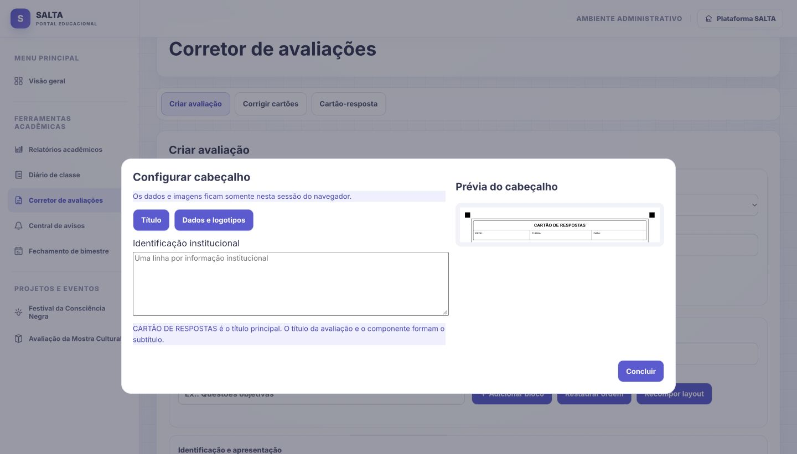
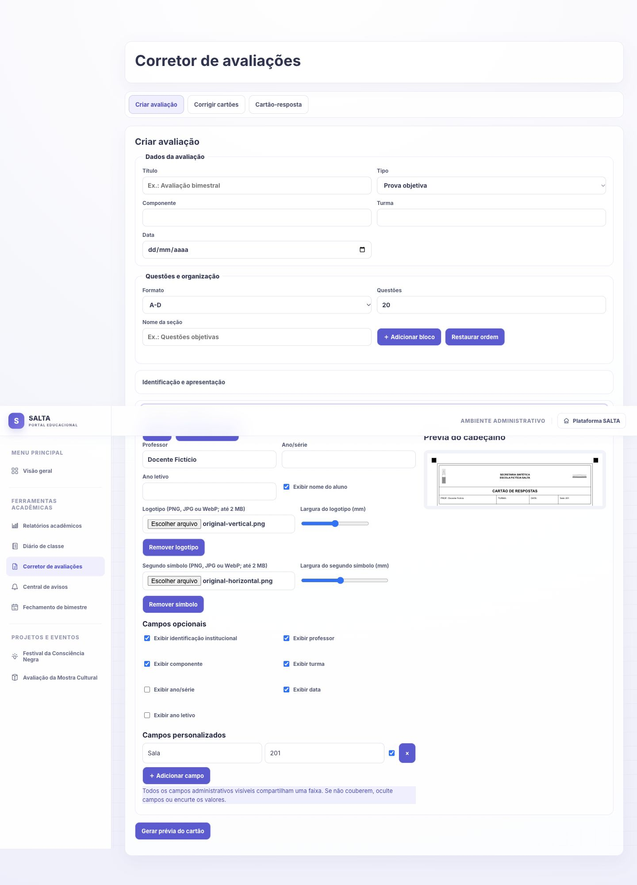
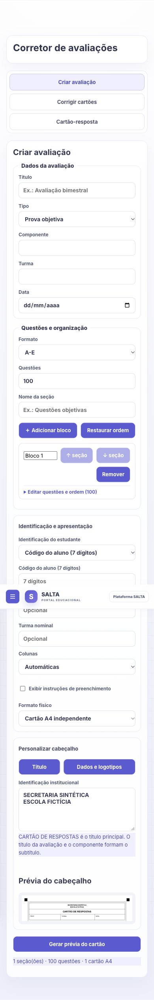
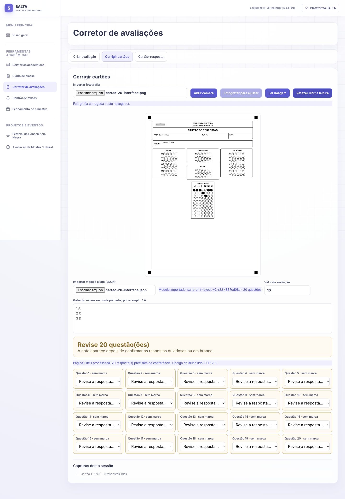

# SALTA — fechamento visual e funcional do Corretor

Implementação e ensaios iniciais: 14/11/2026. Retomada e validação final: 15/11/2026. Base: PR #33, `56e293106a0df912bb26ddfd67a256156e669589`.

## Resultado e limites

O acabamento mantém o cartão V2 aprovado. A interface gera exclusivamente V2, oferece personalização diretamente na página e conserva exportação/importação do JSON exato, inclusive para leitura histórica V1/V2. Nenhum arquivo em `corretor/v2/omr/` foi alterado: renderização, geometria, marcadores, bolhas, hashes, manifestos, leitor e exportadores continuam os da base.

Diário, Workers, D1, autenticação, notas e regras pedagógicas não foram alterados. As únicas mudanças fora da página/CSS/testes/documentação são os parâmetros de cache dos links para o Corretor em `admin-shell.mjs`, `professor.html` e no redirecionamento legado. O hotfix `a93089e` permanece ancestral da branch.

Todos os ensaios usaram pessoas, códigos, instituições, símbolos e respostas sintéticos. A página local de QA simula somente a resposta de sessão e serve os mesmos arquivos do worktree; essa adaptação não integra o código publicado. Testes sintéticos e de interface não equivalem à homologação física do reconhecimento óptico.

## Antes e depois

| Antes | Depois |
|---|---|
| Personalizar cabeçalho abria um diálogo separado | Seção expansível imediatamente abaixo de Identificação e apresentação, com o mesmo componente/estilo |
| Configurações dispersas e geração V1/V2 | Duas seções independentes, inicialmente fechadas; geração V2 interna |
| Histórico local de layouts e ações de guardar/baixar versão | Somente JSON atual na exportação e modelo exato na importação; dados históricos do navegador não são apagados |
| Recompor layout como ação adicional | Composição interna, colunas automáticas/manuais e Restaurar ordem preservados |
| Opção QR permanentemente indisponível e texto inicial redundante | Opção escondida e status de câmera inicialmente vazio; mensagens dinâmicas mantidas |
| Formatos padrão editáveis mesmo com modelo exato ativo | Controles padrão ocultos enquanto um modelo importado/gerado está ativo |

### Evidências visuais

Antes, diálogo em desktop:

Depois, personalização integrada, dois símbolos sintéticos de proporções diferentes:

Depois, celular de 390 px, ambas as seções abertas e dados preservados:

Leitura da imagem inteira e código sintético reconhecido:

Capturas de página inteira podem registrar a barra fixa do shell na posição de rolagem da captura. Isso não representa uma barra inserida no formulário ou no cartão.

## Alterações e falhas objetivas corrigidas

1. **Seções expansíveis:** `
/
` nativos, sem `open` inicial. Recolher não remove campos nem reinicializa valores. Título e Dados e logotipos preservam todos os campos, dois arquivos, dimensões, visibilidade, campos personalizados e prévia. Tablist usa rótulos, painéis relacionados, seleção ARIA, roving tabindex e setas/Home/End. Foco visível nas duas seções.
2. **Ordenação para baixo:** os handlers de seção e questão atribuíam os elementos na mesma ordem, sem efetuar a troca. Corrigida somente a permuta. Restaurar ordem recompõe a ordem original sem redefinir colunas ou opções independentes.
3. **Impressão em lote:** os controles de ordenação e seleção de páginas não eram aplicados ao lote. Agora as funções existentes `sortStudentRoster` e `selectStudentPages` são usadas antes de abrir o documento. Imprimir um cartão não depende de configurações do lote.
4. **Fotografias grandes eram cortadas:** reprodução com PNG de 2480 × 3508 px; o canvas era reduzido para 1273 × 1800, mas `drawImage` desenhava no tamanho original. O resultado era um recorte do canto superior esquerdo, prejudicando normalização/leitura. Ambos os caminhos de decodificação agora desenham a imagem inteira nas dimensões do canvas. Trata-se da entrada de imagem no frontend; normalizador, câmera e algoritmo OMR permanecem intocados. No navegador, a imagem corrigida reconheceu `0001200` e as 20 respostas em branco.
5. **Prévia da fotografia:** proporção visual preservada ao combinar limites de largura/altura; canvas vazio fica oculto até carregar imagem. A correção CSS não altera pixels nem coordenadas de leitura.
6. **Erros e estados:** status de operação comum às três áreas, exportações inicialmente desabilitadas e habilitadas somente com prévia válida; editar apenas o cabeçalho não mostra erro de seção inexistente. O status comum é oculto na impressão. A mensagem da nota provisória identifica acertos, evitando chamá-los de respostas conferidas. Nenhuma fórmula mudou.
7. **Modelo padrão de leitura:** editar seus campos invalida somente o modelo padrão e a revisão correspondente, sem modificar os blocos da criação. Modelos exatos importados/gerados ficam protegidos dessas alterações.

## Inventário dos controles e verificação

Todos os IDs literais referenciados pelo JavaScript são verificados por teste contra o HTML. As linhas abaixo agrupam controles que compartilham fluxo, validação e comportamento; os controles dinâmicos de cada seção/questão são gerados com rótulos próprios.

| Controles | Evento e resultado | Erro/estado e acessibilidade | Verificação |
|---|---|---|---|
| Navegação Criar / Corrigir / Cartão | Click alterna painel e `aria-current`; sair da leitura fecha câmera ativa | Botões nomeados; painéis inativos ocultos | Navegador desktop/mobile; fonte do fechamento da câmera |
| Título, tipo de avaliação, componente, turma, data | Change atualiza metadados e recompõe prévia | Validação de capacidade preservada; labels nativos | Fonte, regressões e geração real |
| Formato, quantidade, nome do bloco, Adicionar | Adiciona questões com IDs/números preservados | Total inteiro 1–150 e capacidade A4; erros no status | 20/50/100 reais; regressões de limites |
| Nome/↑/↓/Remover seção | Renomeia, move ou remove bloco | Extremos desabilitados; `aria-label` por seção | Handlers reais em teste; movimentação no navegador |
| Editar questões; formato e ↑/↓ questão | Expande lista, troca formato ou ordem | Extremos desabilitados; rótulo por número; lista responsiva | Handlers reais e navegador; classe de grade corrigida |
| Restaurar ordem | Ordena blocos por ordem original e questões por número | Não toca colunas/CDU | Teste executa handler; navegador com 3 colunas |
| Duas seções expansíveis | Enter/Espaço/click abre/fecha independentemente | Estado expandido nativo, foco visível, valores persistem | Desktop 1440 px e celular 390 px |
| Identificação, código, nome e turma nominais | Atualiza identidade e prévia | Código validado com 7 dígitos; campos condicionais; QR oculto | Nominal `0001200`, manual com nome e sem região de código; regressões `none` |
| Colunas, instruções, formato físico e dimensões | Composição manual/automática e quadro incorporado | Limites preservados; aviso contextual de leitura incorporada | 3 colunas reais; matriz raster/geométrica; fonte |
| Abas Título / Dados e logotipos | Click/setas/Home/End seleciona painel | Tablist/tab/panel, ARIA e foco | Navegador e handler real em teste |
| Instituição multilinha e professor/ano/série/ano letivo | Input/Change atualiza cabeçalho e prévia | Capacidade/legibilidade preexistentes, sem comprimir texto | Persistência e prévia reais; testes de campos extensos |
| Visibilidade de instituição/professor/componente/turma/ano/data/nome | Change altera só campo habilitado | Labels nativos; valores preservados ao ocultar | Fonte e regressões de cabeçalho |
| Dois logos / dois sliders / duas remoções | Upload valida, ajusta proporção; slider redimensiona; remover limpa arquivo e imagem | PNG/JPG/WebP até 2 MB, limites de dimensões; erro recuperável | Upload/remoção dos dois no navegador; inválido rejeitado; raster quadrado/vertical/horizontal/duplo |
| Campos personalizados: adicionar/rótulo/valor/visibilidade/remover | Atualiza lista e prévia | Labels programáticos, limites de comprimento/capacidade | Inclusão, alteração e remoção reais; regressões de sete campos |
| Gerar prévia | Compõe cartão e abre Cartão-resposta | Exportação só com prévia válida; sem geração V1 | Geração real 20/50/100, manual/nominal e colunas |
| SVG / PNG / JPG / JSON | Download do modelo atual | Erros no status visível; inicialmente desabilitados | Quatro downloads reais; raster 300 DPI e roundtrip JSON |
| Imprimir cartão | Abre documento A4 com manifesto atual | Prévia obrigatória e erro de popup bloqueado | PDF real salvo pelo Chrome, renderizado e inspecionado; handlers e regressões A4 |
| Lote: alunos, ordem, páginas, imprimir | Valida linhas/código; ordena e seleciona páginas | Erros de linha/página antes de abrir documento | PDF real do lote: somente Pessoa M / 0000002 na página 2 alfabética; handler: erro de página e impressão individual independente |
| Importar fotografia | Decodifica, reduz imagem inteira, normaliza e exibe | Tipo/tamanho/45 MP; erro legível e opção manual | PNG real 2480 × 3508, redução corrigida, normalização e leitura |
| Abrir/fechar câmera; Fotografar | Solicita mídia/fecha tracks ou captura frame existente | Fotografar desabilitado até abrir; mensagens de permissão/indisponibilidade | Handlers de erro/fechamento testados; hardware não homologado |
| Ler imagem | Usa modelo exato/padrão e encaminha revisão | Sem imagem pede importação/câmera; sem marcadores pede ajuste; erros preservados | Leitura atual, V1 e V2 históricos no navegador |
| Ajustar quatro cantos | Mostra instruções, coleta TL/TR/BR/BL e normaliza | Progresso 0–4; erro recuperável; canvas rotulado | Quatro cliques reais em imagem sintética sem marcadores detectáveis, seguidos de leitura com 20 brancos |
| Refazer última leitura | Marca próxima captura como substituição | Oculto sem histórico; mensagem orienta retirada da folha | Fonte revisada; caminho de sessão preservado |
| Importar modelo JSON | Importa template/manifesto exatos e mostra versão/hash/quantidade | JSON/tamanho/hash; oculta parâmetros padrão; avisos CDU/incorporado/A-03 | V1 r7 e V2 r8 reais; fixtures anteriores intactas |
| Formato/quantidade padrão V2 | Invalida apenas composição padrão | Ocultos com modelo exato; labels nativos | Handler testado com/sem modelo exato |
| Gabarito e valor | Recalcula proposta local após revisão | Gabarito completo, duplicidade/formato/valor inválido; não grava nota | Gabarito 1–20 C real; suite e fonte |
| Revisão de cada resposta | Select confirma letra ou branco | Marca dupla/branco/ambígua exige conferência; label ligado ao select | Branco: 0,00/10; marca dupla corrigida para C: 0,50/10; nenhum dado real |
| Histórico de capturas da sessão | Atualiza lista das últimas capturas | Não confundir com versões locais de layout removidas | Navegador com leituras sucessivas; fonte |

### Controles removidos

`openHeader`, `closeHeader`, `headerDialog`, `layoutVersion`, `scanLayoutVersion`, `headerLayout`, `cduPosition` (controle exclusivo V1), `layoutHistory`, `saveLayoutVersion`, `downloadLayoutVersion`, `recompose`, opção visual QR indisponível e textos iniciais redundantes. Funções de biblioteca e armazenamento histórico permanecem; a página não chama `localStorage.clear/removeItem` nem reescreve versões salvas.

## Testes e evidências

- Suíte integrada: **93 testes, 93 aprovados**, incluindo dez novos testes de fluxo. Comando: `node --test corretor/v2/tests/*.test.mjs stats-worker/tests/*.test.mjs plataforma/tests/*.test.mjs`.
- Regressão raster: 15 cartões de 10/20/50/100/150 questões e três formatos; brancos, marca C e marcadores corretos; PNG/JPG de 20/50/100 a 300 DPI. Dezoito combinações de identidade/instituição/instruções, código nominal, marcas dupla/fraca e variantes de cabeçalho.
- Logos: quadrado, vertical, horizontal e duplo; transparência, cinza suave, sete campos, marcadores e leitura sem falsos positivos. Nenhuma mudança em filtros/renderizador.
- Modelos históricos: V1 e duas fixtures V2 importáveis e legíveis; 15 digests ópticos históricos preservados. No navegador: V1 r7/hash `95c465a9` e V2 r8/hash `251b8ee0`, 20 respostas em branco cada.
- Navegador: 1440 px e 390 px, sem overflow horizontal nas telas medidas; abertura independente/teclado/persistência, logos, campos personalizados, ordenação, geração 20/50/100, quatro downloads, importação e revisão, ajuste manual e A-03. Nenhum erro de aplicação registrado na aba nova de validação. Uma aba antiga continha avisos de canal de extensão anteriores ao ensaio; não foram tratados como erros do aplicativo.
- PDF A4 real salvo pelo diálogo do Chrome na retomada: `cartao-20-Chrome-A4.pdf`, uma página, 594,95996 × 841,91998 pt, título CÓDIGO DO ALUNO e código 0001200; renderizado com Poppler e inspecionado. Lote alfabético com seleção 2: `lote-pagina-2-Chrome-A4.pdf`, somente Pessoa M / 0000002, uma página A4. Uma prova derivada de PNG anterior continua no pacote, identificada como tal. O HTML de impressão permanece com `@page size:A4 portrait; margin:0`, SVG 210 × 297 mm e manifesto exato.
- Na retomada, a suíte completa passou novamente com 93 testes; as duas regressões raster também passaram. Sintaxe de todos os módulos OMR/admin-shell e quatro scripts inline das três páginas HTML alteradas: OK. Referências DOM, `git diff --check` e comparação dos diretórios protegidos: OK.

Pacote completo local: `outputs/corretor-fechamento-visual/`, na pasta SALTA que contém o worktree. Inclui pedido aprovado, capturas, métricas JSON, exports reais, diagnóstico do recorte, manifestos sintéticos/históricos de teste, logs, prova A4 e regressões raster. Capturas selecionadas e este relatório são versionados no GitHub; o pacote integral permanece local.

## Pendências e recomendações

### P1 — A-03, numeração não contínua

Confirmado novamente por UI com questões **2 e 7**: importar o JSON exibe aviso A-03; ler a imagem retorna “O leitor atual exige numeração de 1 até o total de questões”. Não é cenário homologado e não produz proposta de nota. Para reproduzir pelo gerador, adicionar dois blocos e remover o primeiro, preservando os números do segundo. O código de correção/gabarito ainda depende da relação com números/índices; não foi reestruturado nem houve renumeração silenciosa. Usar sequência **1–N** na correção até ciclo funcional dedicado.

### P1 — homologação física

Ensaiar impressão em 100%, medidas, câmera real, canetas, sombras, inclinação, impressoras e celulares distintos. CDU e quadros incorporados continuam imprimíveis, porém sem leitura automática homologada. O diálogo nativo do Chrome foi validado digitalmente, inclusive PDF individual e lote; papel e câmera físicos permanecem pendentes. Os PDFs e testes digitais não substituem esses ensaios.

### P2 — acessibilidade especializada

As melhorias de semântica, foco, teclado, rótulos e estados foram verificadas. Auditoria com leitor de tela e alternativas ao ajuste manual por quatro pontos exige ensaio dedicado. Não se declara conformidade WCAG completa.

## Publicação e reversão

Merge e Pages foram expressamente autorizados no pedido desta missão após CI e revisão satisfatórias. Os links e o SHA efetivamente publicados serão entregues no fechamento, após conferir o build Pages, os arquivos HTTP e o fluxo expansível autenticado. Reversão: reverter o commit de manutenção pela via de PR; nenhuma migração ou reversão de dados é necessária.
