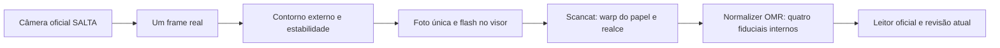

# SALTA — PACOTE DE CÓDIGO E AUDITORIA
## OMR-SCAN-20Q / para DIRETOR, EXECUTOR, CODEX, AUDITOR e HOMOLOGADOR

**Snapshot de código para todos os links:** `ca3216112c45860743bfa21ee9efcac7035263ac`, branch `main` **antes** do registro documental.  
**Status:** fontes já versionadas e disponíveis para leitura integral no GitHub; **integração no Corretor ainda NÃO implementada**.  
**Documento de comando:** [encaminhamento ao Diretor](SALTA_OMR_SCAN_20Q_ENCAMINHAMENTO_DIRETOR_20261124.md).  
**Manifesto legível por máquina:** [lista de arquivos, SHA dos blobs, papéis e links](SALTA_OMR_SCAN_20Q_FONTES_AUDITORIA_20261124.json).

> **Entrega de código:** o repositório já contém **todo o código-fonte da experiência e do Corretor**. Cada link abaixo é um permalink para um conteúdo imutável, não uma promessa de código ainda não escrito. O que falta é um **adaptador oficial futuro**, a ser desenvolvido em branch sob coordenação da Diretoria, testado e submetido a PR; não declarar isso como pronto.

### 1. Arquivos-fonte para auditoria

| Papel | Código completo no snapshot imutável | Funcionalidade |
|---|---|---|
| Núcleo óptico aprovado (código completo) | [`laboratorio/salta-omr-capture-lab/js/vision.js`](https://github.com/d4nny3l/portal-do-aluno/blob/ca3216112c45860743bfa21ee9efcac7035263ac/laboratorio/salta-omr-capture-lab/js/vision.js) | detectDocument, outputSize, warp, enhance |
| Pipeline de processamento (código completo) | [`laboratorio/salta-omr-capture-lab/js/worker.js`](https://github.com/d4nny3l/portal-do-aluno/blob/ca3216112c45860743bfa21ee9efcac7035263ac/laboratorio/salta-omr-capture-lab/js/worker.js) | warp → enhance → rotate |
| Orquestrador do experimento (referência, NÃO copiar inteiro) | [`laboratorio/salta-omr-capture-lab/js/app.js`](https://github.com/d4nny3l/portal-do-aluno/blob/ca3216112c45860743bfa21ee9efcac7035263ac/laboratorio/salta-omr-capture-lab/js/app.js) | 10 quadros estáveis, captura única, flash, eventos |
| Ponte experimental para o OMR oficial | [`laboratorio/salta-omr-capture-lab/omr-lab.mjs`](https://github.com/d4nny3l/portal-do-aluno/blob/ca3216112c45860743bfa21ee9efcac7035263ac/laboratorio/salta-omr-capture-lab/omr-lab.mjs) | comparativo A/B, normalização original |
| Estado antiduplicidade (referência restrita) | [`laboratorio/salta-omr-capture-lab/js/card-flow.js`](https://github.com/d4nny3l/portal-do-aluno/blob/ca3216112c45860743bfa21ee9efcac7035263ac/laboratorio/salta-omr-capture-lab/js/card-flow.js) | um cartão por captura, sem bloqueio manual |
| Motor da câmera oficial — manter | [`corretor/v2/omr/camera.mjs`](https://github.com/d4nny3l/portal-do-aluno/blob/ca3216112c45860743bfa21ee9efcac7035263ac/corretor/v2/omr/camera.mjs) | CameraSession, drawVideoFrame, containMapping, foco/zoom/torch |
| Código oficial do Corretor — alvo mínimo | [`plataforma/corretor-v2.html`](https://github.com/d4nny3l/portal-do-aluno/blob/ca3216112c45860743bfa21ee9efcac7035263ac/plataforma/corretor-v2.html) | scanCameraFrame, prepareImage, toPageRaster, readNormalized |
| CSS oficial — não reformular | [`plataforma/corretor-v2.css`](https://github.com/d4nny3l/portal-do-aluno/blob/ca3216112c45860743bfa21ee9efcac7035263ac/plataforma/corretor-v2.css) | visor e interface atuais |
| Normalizador oficial — preservar | [`corretor/v2/omr/normalize.mjs`](https://github.com/d4nny3l/portal-do-aluno/blob/ca3216112c45860743bfa21ee9efcac7035263ac/corretor/v2/omr/normalize.mjs) | fiduciais, warpFromFiducials, normalizeCard |
| Classificador oficial — preservar | [`corretor/v2/omr/reader.mjs`](https://github.com/d4nny3l/portal-do-aluno/blob/ca3216112c45860743bfa21ee9efcac7035263ac/corretor/v2/omr/reader.mjs) | readRaster, classificação/revisão |
| Licença obrigatória | [`laboratorio/salta-omr-capture-lab/LICENSE-SCANCAT-MIT.txt`](https://github.com/d4nny3l/portal-do-aluno/blob/ca3216112c45860743bfa21ee9efcac7035263ac/laboratorio/salta-omr-capture-lab/LICENSE-SCANCAT-MIT.txt) | crédito Nipun Batra |
| Teste antirrepetição já existente | [`laboratorio/salta-omr-capture-lab/tests/paper-safe.test.mjs`](https://github.com/d4nny3l/portal-do-aluno/blob/ca3216112c45860743bfa21ee9efcac7035263ac/laboratorio/salta-omr-capture-lab/tests/paper-safe.test.mjs) | regressão histórica reaproveitável seletivamente |

Para comparação histórica e exclusão deliberada:

- [`laboratorio/salta-omr-capture-lab/js/framing.js`](https://github.com/d4nny3l/portal-do-aluno/blob/ca3216112c45860743bfa21ee9efcac7035263ac/laboratorio/salta-omr-capture-lab/js/framing.js) — solução independente de viewport/crop **NÃO APROVADA** para a câmera do Corretor.
- [`laboratorio/salta-omr-capture-lab/js/quality.js`](https://github.com/d4nny3l/portal-do-aluno/blob/ca3216112c45860743bfa21ee9efcac7035263ac/laboratorio/salta-omr-capture-lab/js/quality.js) — detecção de desfoque e burst abandonados, **NÃO TRANSPLANTAR**.
- [`laboratorio/salta-omr-capture-lab/js/marker-capture.js`](https://github.com/d4nny3l/portal-do-aluno/blob/ca3216112c45860743bfa21ee9efcac7035263ac/laboratorio/salta-omr-capture-lab/js/marker-capture.js) — gatilho por quatro quadrados abandonado, **NÃO USAR PARA CAPTURA AO VIVO**.
- [`laboratorio/salta-omr-capture-lab/js/paper-geometry.js`](https://github.com/d4nny3l/portal-do-aluno/blob/ca3216112c45860743bfa21ee9efcac7035263ac/laboratorio/salta-omr-capture-lab/js/paper-geometry.js) — correção experimental de limites/margens **NÃO INCORPORAR AUTOMATICAMENTE**, por não ser parte comprovada da câmera oficial.

**Cópia do repositório:** `git clone https://github.com/d4nny3l/portal-do-aluno.git && cd portal-do-aluno && git checkout ca3216112c45860743bfa21ee9efcac7035263ac`. Este checkout é **somente de leitura/comparação**, não para publicar alterações de produção. Trabalhar em branch a partir da `main` atual quando a Diretoria abrir a missão.

### 2. Integrar o código sem mover a câmera

**Ponto exato na aplicação:** `plataforma/corretor-v2.html`:

- `scanCameraFrame()` lê quadros com `drawVideoFrame()`. O gatilho de captura deve avaliar **contorno externo da folha** e estabilidade como no `app.js` aprovado (10 quadros, filtro 0,45, deslocamento máximo de 2% da largura), usando a câmera **que já está aberta**.
- A fotografia efetiva deve vir de **uma única aquisição** no vídeo oficial. O adaptador pode usar o mesmo canvas de aquisição para obter **RGBA e cinza do mesmo instante**, pois o scanner usa RGBA, enquanto as funções de qualidade/correção existentes podem exigir tons de cinza. Não fazer dois `video.drawImage` desconectados temporalmente.
- A conversão de cantos do contorno reduzido para os pixels da imagem final deve respeitar o mapeamento geométrico real do vídeo, não tamanhos CSS.
- O scanner usa `outputSize()`, `warp()` (homografia do PAPEL) e `enhance()` em arquivo local/processamento local, podendo manter cópia original para fallback. Após obter o RGBA retificado, converte para grayscale e segue pelo **`prepareImage` oficial sem `manualCorners`**, para que o Corretor encontre os **FIDUCIAIS INTERNOS** por `toPageRaster()/normalizeCard()` e então chame `readNormalized()`.
- Se um passo falhar, não criar marcações, não inferir resposta definitiva, não adulterar gabarito/identificação; manter a captura original e permitir o mecanismo de falha/recaptura **já existente** no Corretor.
- `CameraSession.open`, `CameraSession.stop`, `replaceCameraVideo`, controles nativos de câmera, timer/orientação do visor, foco, torch, zoom, troca de lente, mensagens e páginas permanecem conforme o projeto **original do Corretor**. O único ajuste legítimo a `scanCameraFrame()` é o encaixe da busca da folha e da captura escaneada.

**Não há código integrado de produção neste registro.** O Executor deve submeter seu patch real; o Auditor deve medir seu diff e não aceitar descrição de alto nível no lugar da implementação.

### 3. Contratos visuais — inalteráveis salvo dois sinais

**Obrigatório preservar:** todos os textos, `textContent`, HTML estático, quantidade de controles, IDs, botões, navegação, tamanho do visor, posicionamento da câmera, guia de lente, sliders, dropdowns, cores gerais, respostas, nota, revisão e histórico.

**ÚNICAS exceções visíveis permitidas dentro da área já ocupada pelo vídeo:**

1. **Contorno externo da folha**: polígono transparente, posição calculada pelos quatro cantos do papel, reaproveitando a área/elementos atuais de `#cameraStage`; não alterar as guias dos fiduciais existentes nem adicionar legenda. Pode ser desenhado por uma camada interna com `pointer-events:none` e posicionamento absoluto que não participe do layout.
2. **Flash fotográfico**: sobreposição visual breve no mesmo `#cameraStage`, ativada somente após capturar o frame efetivo. Não adicionar texto nem elemento que ocupe espaço; respeitar preferência de movimento reduzido.

O Auditor Visual deve comparar o mesmo `plataforma/corretor-v2.html` antes/depois: diferenças em texto visível, cabeçalhos, ações, controles, seções, iconografia, grade, zoom, webcam ou altura do visor são **bloqueantes**. A única diferença esperada em execução são as duas animações/sinais dentro do visor.

### 4. Diagramas de responsabilidade



**Não trocar as geometria dos quatro cantos do papel pela dos quatro marcadores do cartão.** Primeira homografia retifica o documento; segunda normalização óptica preserva o contrato da folha de respostas. Não entregar o quadrilátero do papel como quatro fiduciais.

### 5. Suite mínima de auditoria

| Suite existente | Aspecto a preservar |
|---|---|
| `plataforma/tests/corretor-omr-camera-cross-integration.test.mjs` | Fluxo real de câmera, `prepareImage`, `readNormalized`, duplicatas, revisão, nota |
| `plataforma/tests/int-scan-01-frame-choice.test.mjs` | **Uma única fotografia**, sem burst nem seleção dupla; rejeição de frame final inadequado |
| `corretor/v2/tests/camera.test.mjs` | Seleção, cancelamento, foco/zoom/torch nativos, geometria e estabilidade |
| `corretor/v2/tests/normalize.test.mjs` | Perspectiva, fidelidade, marcadores |
| `corretor/v2/tests/normalize-low-light.test.mjs` | Fallback já existente de baixa luz |
| `corretor/v2/tests/reader-partial-marks.test.mjs` | Marcação parcial, branco, duplas, revisão |
| `corretor/v2/tests/reader-auditor-adversarial.test.mjs` | Casos adversos e decisões não precipitadas |
| `laboratorio/salta-omr-capture-lab/tests/paper-safe.test.mjs` | Histórico de captura única; escolher somente invariantes aprovadas |

**ATENÇÃO:** uma suíte existente pode codificar a política anterior de busca por fiduciais antes da captura. Se o novo plano trocar **apenas o gatilho interno** pela busca estável do papel, os testes afetados devem ser atualizados com justificativa explícita, preservando os mesmos critérios de segurança e a câmera física. Não “fazer os testes passarem” removendo asserts críticos.

**Testes adicionais obrigatórios no PR candidato:**

- Snapshot de DOM/strings: nenhuma mudança de texto, label, botão, estrutura, grid ou id. A única camada nova pode existir **dentro do visor**.
- Regra de controle: `corretor/v2/omr/camera.mjs` permanece idêntico ao SHA de referência, salvo necessidade comprovada e autorização do Diretor; `reader.mjs` e manifesto permanecem idênticos.
- Dados sintéticos pareados: fotografia A4 com os marcadores internos e marcas nas 20 questões, fundos claro/escuro/estampado, sombras, obliquidade, áreas saturadas, quadro cortado e tremor; processar a **mesma aquisição** pelo caminho bruto e pelo caminho escaneado.
- Fidelidade: marcador, alternativa, código, identidade, hash, estado e nota não podem ser alterados de forma indevida; “20 lidas” sem verificar as alternativas contra a verdade da prova não fecha a homologação.
- Erros controlados: folha parcialmente fora do quadro, ausência de contorno estável, câmera sem permissão, WebKit sem foto, `canvas` indisponível, Worker lento/falho; nunca criar várias notas nem travar a câmera.
- Captura única por folha e liberação após retirada real; comprovar que o flash dispara **uma vez** e que a foto processada nunca corresponde a frame diferente dos cantos.
- Auditoria de licença: preservar `LICENSE-SCANCAT-MIT.txt`, aviso Copyright (c) 2026 Nipun Batra e documentação de atribuição.

**Executar na branch candidata, com dependências/CI atuais, somente depois de o patch existir:**
```sh
node --test plataforma/tests/corretor-omr-camera-cross-integration.test.mjs
node --test plataforma/tests/int-scan-01-frame-choice.test.mjs
node --test corretor/v2/tests/camera.test.mjs
node --test corretor/v2/tests/normalize.test.mjs corretor/v2/tests/normalize-low-light.test.mjs
node --test corretor/v2/tests/reader-partial-marks.test.mjs corretor/v2/tests/reader-auditor-adversarial.test.mjs
```
Testes de raster que demandem `sharp` devem usar o ambiente/CI já previsto no repositório. **Nenhum teste dessa futura integração pode ser marcado como executado hoje.**

### 6. Provas para o Homologador

**Registro confirmado por relato do proprietário:** 20/20 questões reconhecidas no laboratório estável em ambiente hostil. Não há fotografia/planilha com a verdade das alternativas anexada a este documento.

O Homologador deve obter evidência no aparelho físico (sem divulgar dados de aluno): 
1. Versão exata do commit, dispositivo e navegador, foto sintética/autorizada e cartão conhecido (20 perguntas).
2. Resultado bruto vs. scan em cada pergunta, com verdade conhecida, não apenas contagem.
3. Foto da folha completamente visível, visualização do retângulo e do único flash.
4. Repetição após retirar e colocar outro cartão, sem capturas múltiplas.
5. Comparação de casos em luz normal, sombras, baixa luminosidade, fundo complexo e diferentes distâncias.
6. Comparativo de antes/depois da **mesma câmera oficial**, sem mudanças no layout nem labels.

### 7. Protocolo para agentes e Diretoria

- **DIRETOR:** aprovar escopo P1 e distribuir missão, separar execução/auditoria/homologação.
- **EXECUTOR/CODEX:** criar branch nova só para a integração, referenciar o snapshot acima, manter diff mínimo e explicar cada arquivo. PR com HEAD e testes.
- **AUDITOR:** só leitura; reportar `APTO`, `APTO COM RESSALVAS` ou `BLOQUEADO`, incluindo SHA do HEAD auditado. Sem merge.
- **AUDITOR VISUAL:** provar inexistência de alterações de interface além de contorno da folha e flash.
- **HOMOLOGADOR:** validar em iPhone físico com o proprietário. Não confundir simulação com câmera real.
- **DIRETOR:** após pareceres independentes e autorização expressa do proprietário, coordenar publicação. **Este registro não autoriza mudanças no Corretor oficial.**

### 8. Ligação com tarefas anteriores

- `docs/SALTA_CAMERA_OMR_FIDELIDADE.md` — preservar proporção, guias, fidelidade da câmera.
- `docs/SALTA_INTEGRACAO_OMR_CAMERA_P1_20261118.md` — preservar integração atual da câmera com o OMR.
- `docs/SALTA_OMR_BAIXA_LUMINOSIDADE_P1.md` — não destruir fallback óptico oficial em baixa luz.
- `plataforma/tests/int-scan-01-frame-choice.test.mjs` — prevenir retorno de algoritmo de escolha entre várias fotos já removido.
- `docs/SALTA_OMR_SCAN_20Q_ENCAMINHAMENTO_DIRETOR_20261124.md` — fonte oficial do escopo desta missão.

**Conclusão:** a prova de conceito é promissora; o código está integralmente acessível e versionado; a integração oficial permanece uma tarefa futura, sujeita à Diretoria e às auditorias.
